# Additional Server Service – Nextcloud

| Student Name | Tsen Pei Hong |
|---|---|
| Kaplan ID | CT0375497 |
| Murdoch ID | 36431456 |
| Module | BRG-31-ISEA – Introduction to Server Environments and Architectures |
| Date | 16 Nov 2026 |

## Overview

For my additional server service I chose Nextcloud, a self-hosted file sharing and collaboration server (similar to Google Drive or OneDrive, but running on my own server). I installed it on my local Ubuntu VM, created users, and tested file sharing between them.

| Service | Nextcloud 35.0.3 (snap package) |
|---|---|
| Server | Ubuntu 26.04 VM in VirtualBox (local) |
| Access | http://localhost:8081 from Windows (VirtualBox port forward 8081 → 8081) |
| Accounts | admin (administrator), bob (normal user) |

Why port 8081: Apache from Lab 1b-1 is already using port 80 on this VM, so Nextcloud's own web server was moved to port 8081 to avoid a conflict.

## Steps

### Step 1 – Port forwarding in VirtualBox

Added a NAT port forwarding rule so Windows can reach Nextcloud inside the VM.

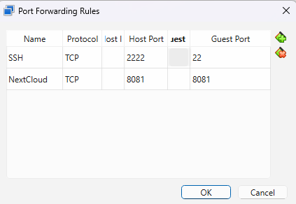

### Step 2 – Install Nextcloud with snap

One command installs Nextcloud together with its own web server, database and PHP.

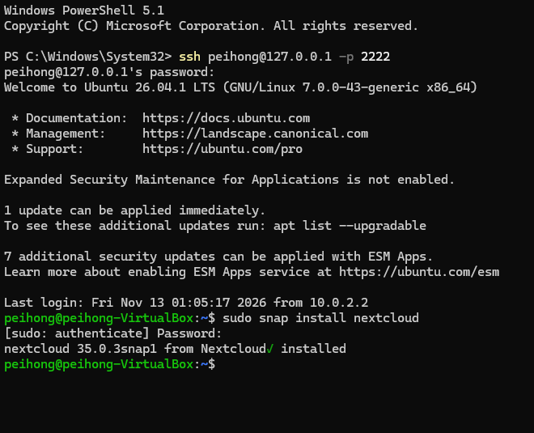

### Step 3 – Configure port, admin account, trusted domain and firewall

Changed the HTTP port to 8081, created the admin account, added localhost as a trusted domain, and allowed port 8081 in UFW.

sudo snap set nextcloud ports.http=8081
sudo nextcloud.manual-install admin <password>
sudo nextcloud.occ config:system:set trusted_domains 1 --value=localhost
sudo ufw allow 8081/tcp

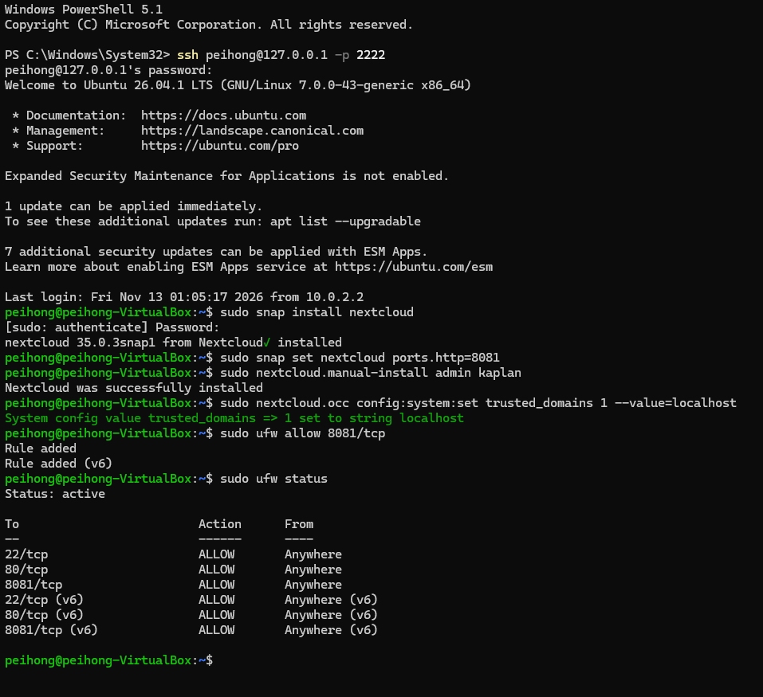

### Step 4 – Log in from the Windows browser

Opened http://localhost:8081 and logged in as admin.

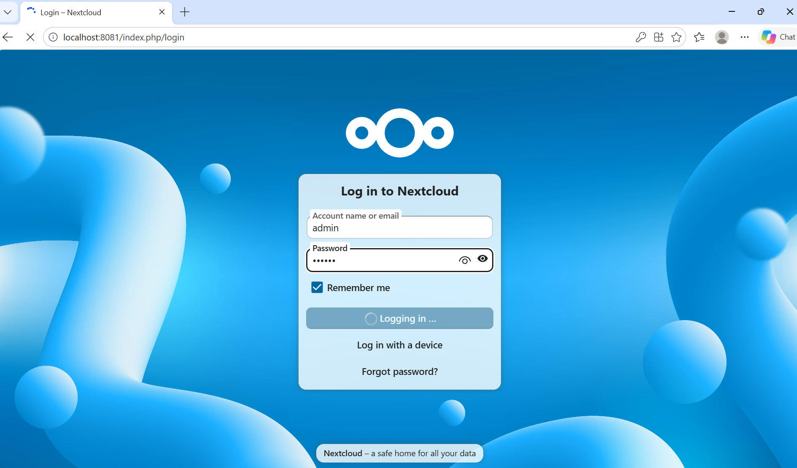

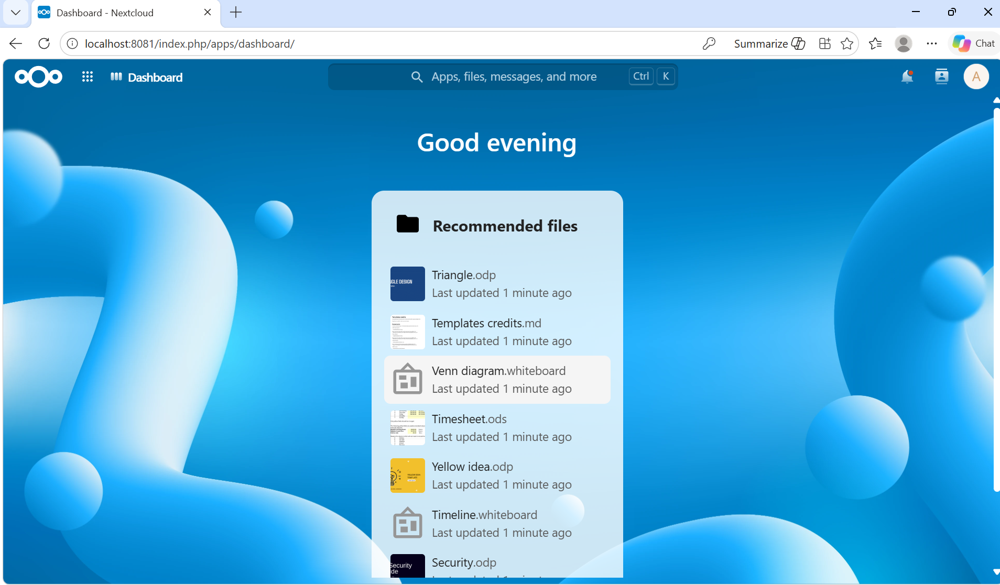

### Step 5 – Upload a file

Uploaded 'Test NextCloud.docx' to the admin's files.

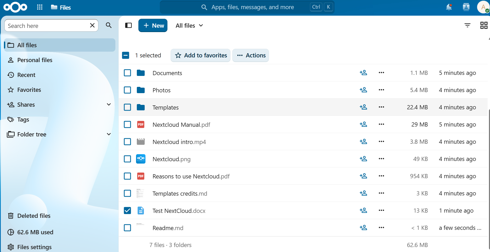

### Step 6 – Create a normal user

Created the account 'bob'. Nextcloud rejected my first password because its password policy requires at least 10 characters.

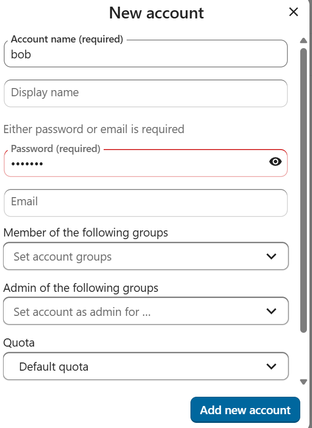

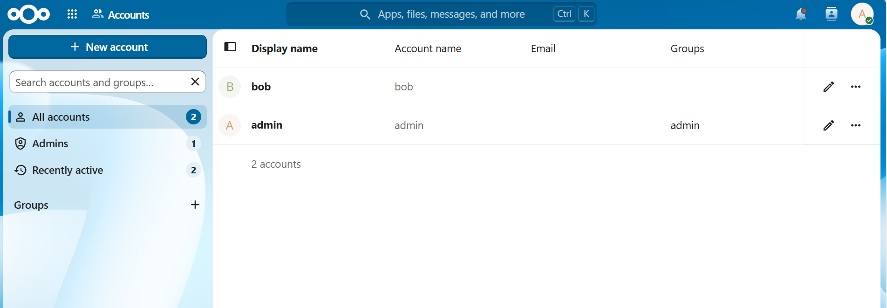

### Step 7 – Share a file with bob (View only)

Shared the file with bob. The options are View only, Allow editing or Custom permissions, with an optional expiration date. I chose View only.

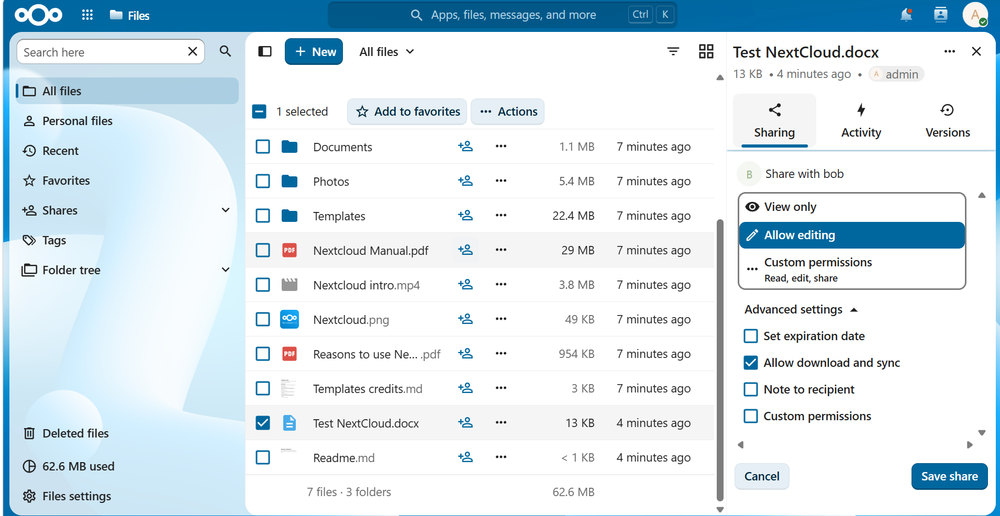

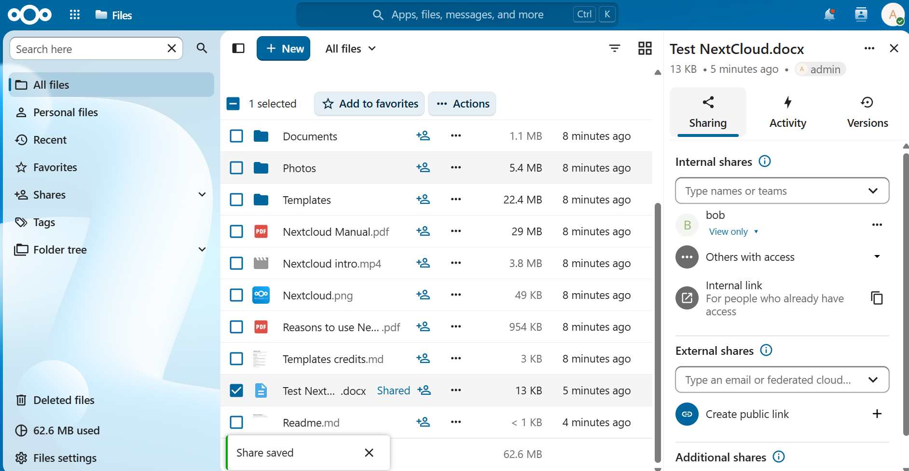

### Step 8 – Test as bob

Logged in as bob in a private window. The shared file appears with 'Shared' and admin's avatar.

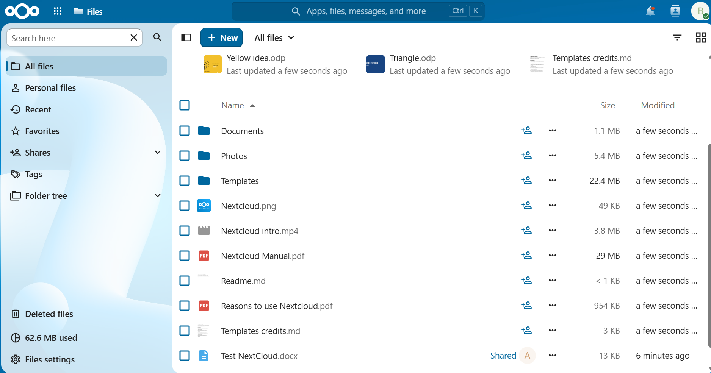

### Step 9 – Check the services

snap services shows that Nextcloud runs several services together: Apache, MySQL, PHP-FPM, Redis and cron.

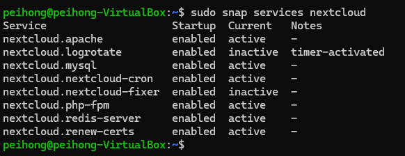

## Reflection

**1. Why did you choose Nextcloud?**

Because Nextcloud is easy to use and has the most complete features.

**2. What problems did you meet during installation, and how did you solve them?**

The installation itself had no problems. When I created the user bob, my password was too short, so it could not pass, because Nextcloud requires a password of at least 10 characters. I solved it by using a longer password.

**3. How could a company use Nextcloud?**

Create accounts for staff and assign the right folders to each user so they can access the files they need.

**4. What security settings would you add before a company uses it?**

Definitely set up a firewall on the server.

## AI Tools Used

I used Claude to guide me through the installation steps and commands, format this document, and translate my answers from Chinese to English. I did the installation and testing myself, and the reflection answers are my own ideas.
