# Lab 1b-1 – Linux Services

| Student Name | Tsen Pei Hong |
|---|---|
| Kaplan ID | CT0375497 |
| Murdoch ID | 36431456 |
| Module | BRG-ISEA – Introduction to Server Environments and Architectures |
| Date | 12 Nov 2026 |
| Environment | Ubuntu 26.04.1 LTS on VirtualBox (accessed from Windows via SSH) |

Note: This lab is designed for two students. As an online student with one VM, I used my own VM (127.0.0.1) in place of the neighbour's machine, and logged in as a second user (webuser) to practise SSH.

## Part 1 – Apache Web Server

### Issue: apt update failed

sudo apt update returned 404 Not Found errors for the Singapore mirror (sg.archive.ubuntu.com).

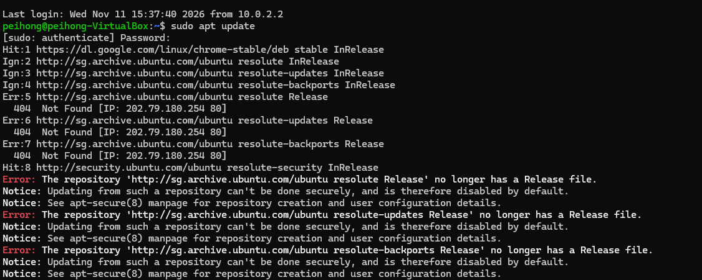

Fix: changed the mirror to the main Ubuntu server with sed, then apt update worked.

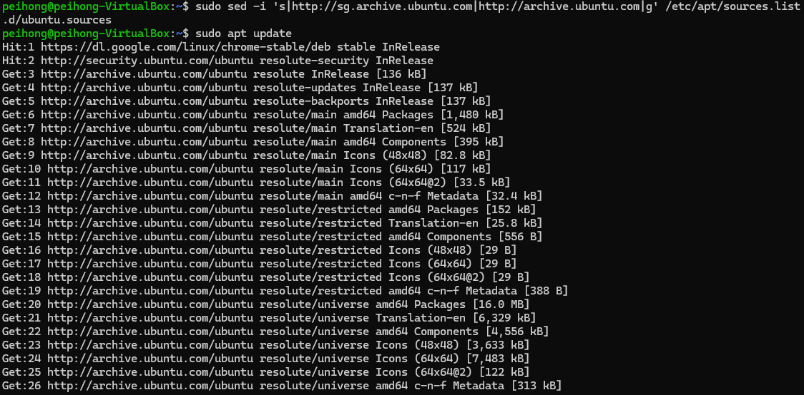

### Install Apache and nmap

sudo apt install -y apache2 nmap (openssh-server was already installed in Lab 1a).

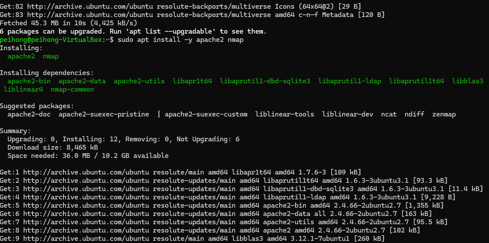

Apache installed and enabled as a service.

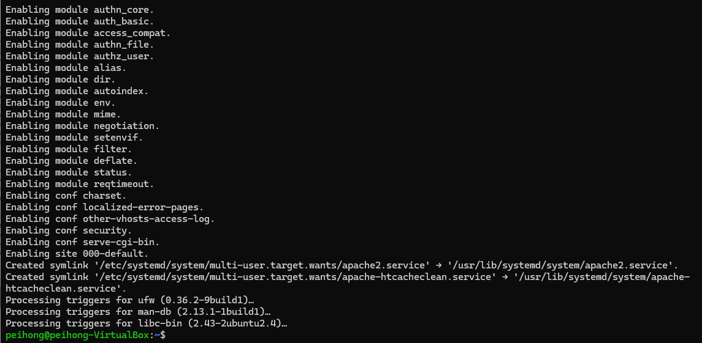

### Edit the web page

Editing /var/www/html/index.html without sudo: nano shows 'File is unwritable' because the file is owned by root.

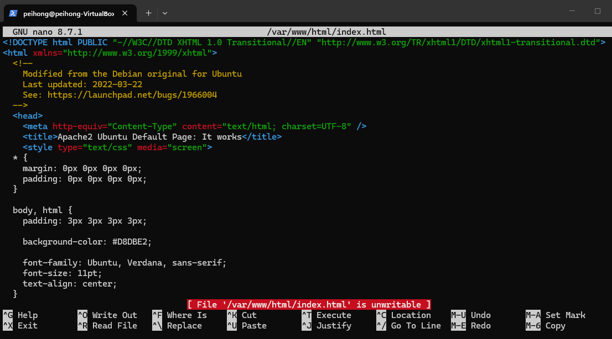

Fixed by using sudo nano. Changed the title to 'Pei Hong's Web Server'.

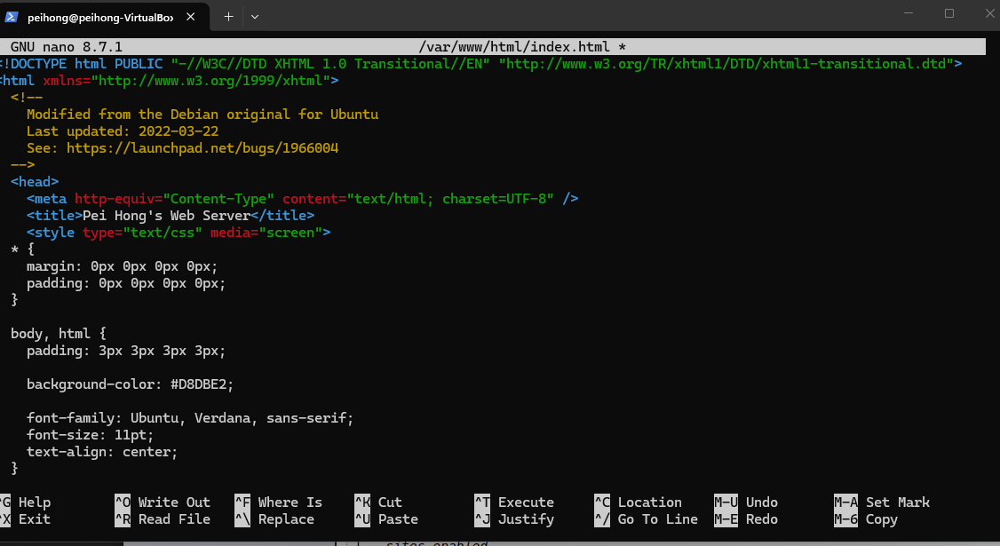

Changed the banner text to 'It works! - Pei Hong'.

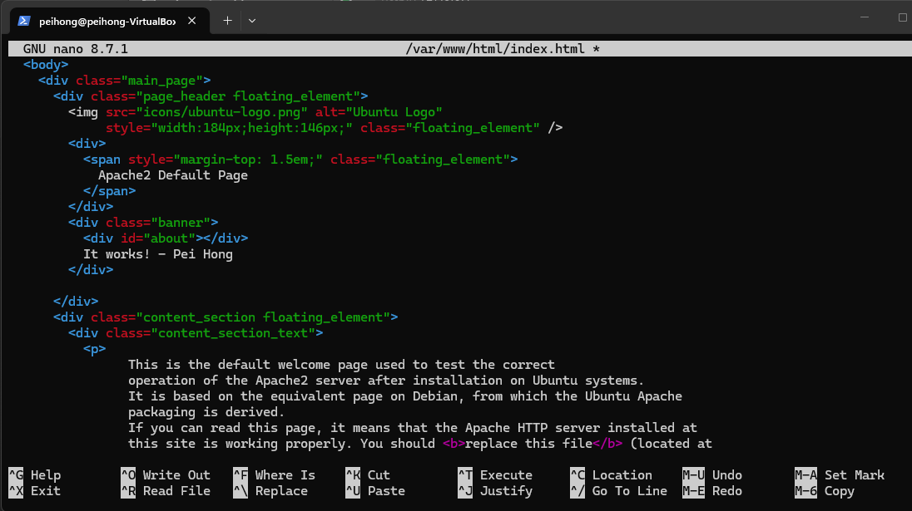

The updated page at http://127.0.0.1 in Firefox.

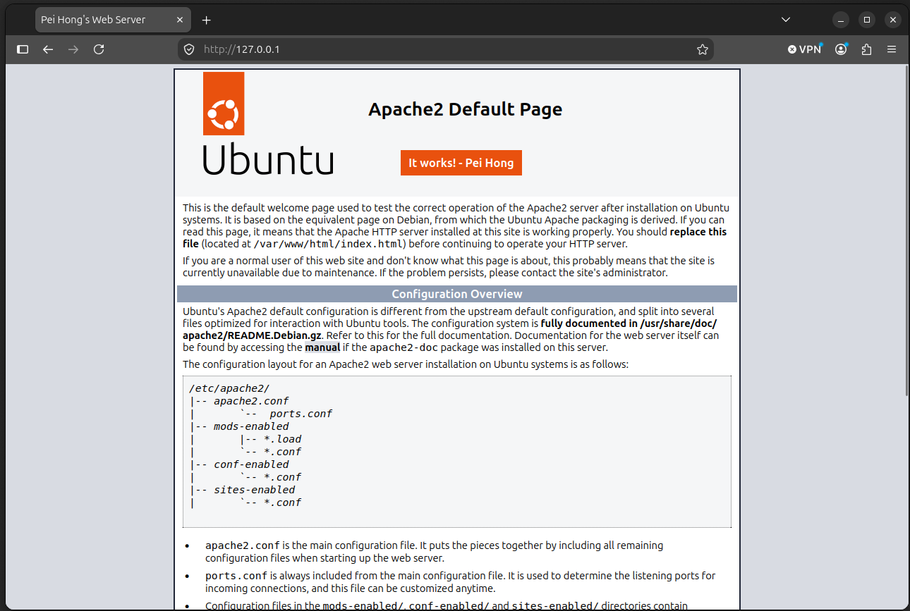

### IP address

ip a shows the loopback address 127.0.0.1 (lo) and the Ethernet address 10.0.2.15 (enp0s3).

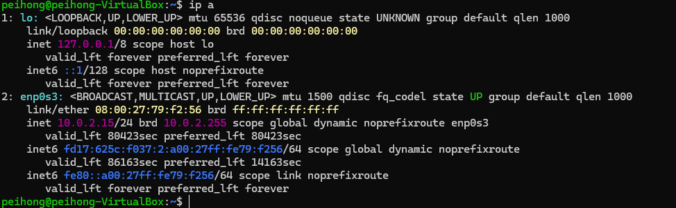

## Part 2 – Nmap

nmap 127.0.0.1 shows three open ports: 22/tcp (ssh), 80/tcp (http – Apache) and 631/tcp (ipp – printing service).

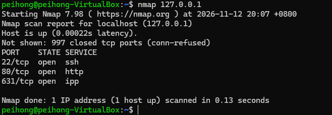

After sudo apt remove apache2, port 80 is no longer open, because no program is listening on it.

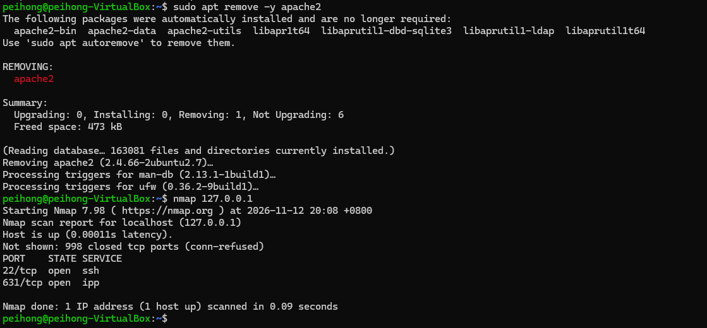

## Part 3 – UFW Firewall

Apache reinstalled. UFW was inactive. I allowed port 22 before enabling the firewall so my SSH session would not be cut off.

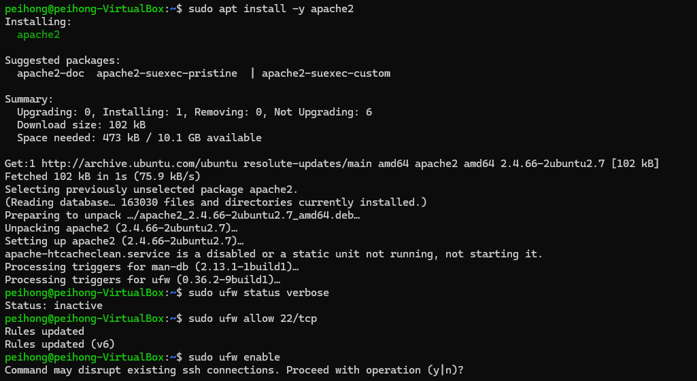

UFW is now active: default deny incoming, allow outgoing. nmap from the same machine still shows the ports, because UFW does not block local (loopback) traffic.

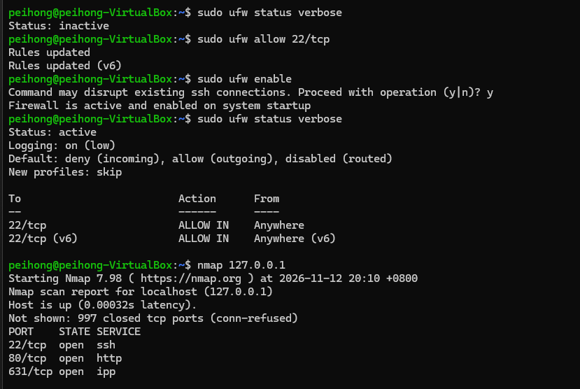

Allowed port 80/tcp so the web server can be reached from outside.

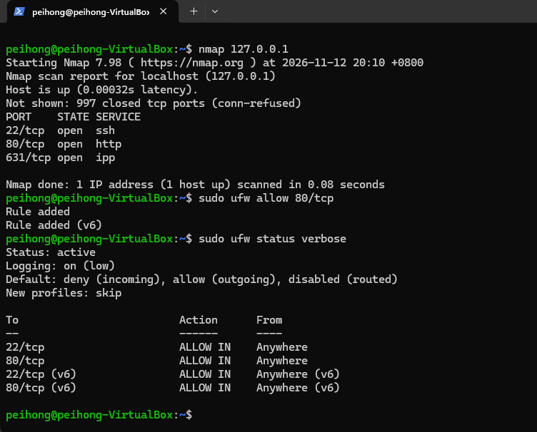

## Part 4 – Users and SSH

/etc/passwd before and after sudo adduser webuser: a new line webuser:x:1002:1002:...:/home/webuser:/bin/bash was added.

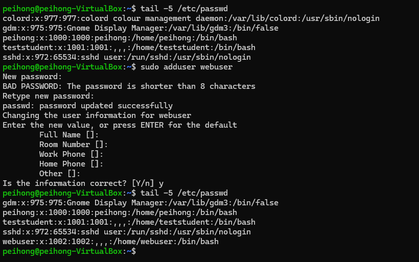

Logged in as the new user with ssh webuser@127.0.0.1.

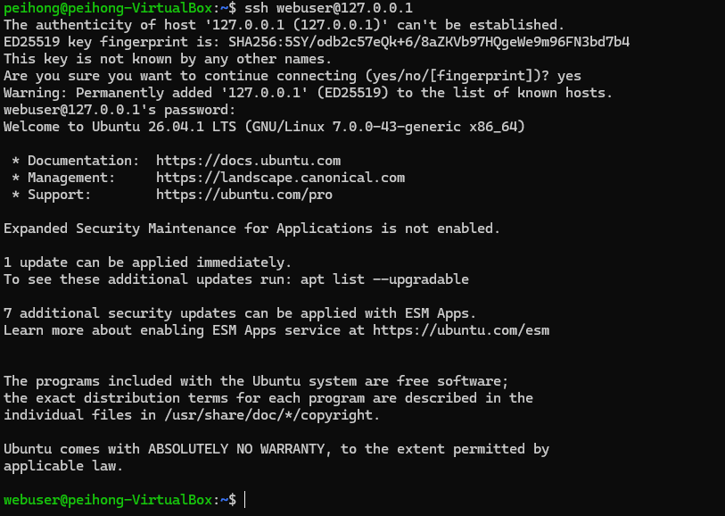

whoami confirms the session is running as webuser.

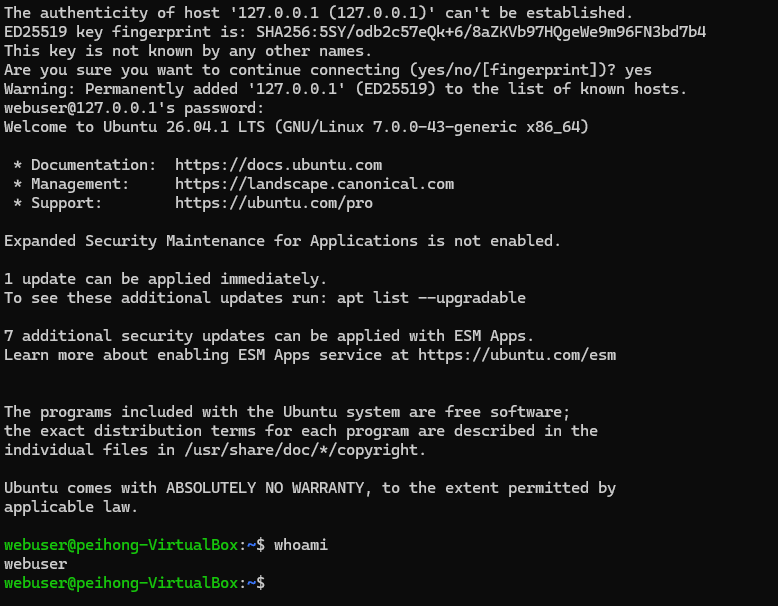

## Part 5 – Compressed Archives

Downloaded three public-domain books from Project Gutenberg with wget into a books folder. The http link was automatically changed to https (HSTS).

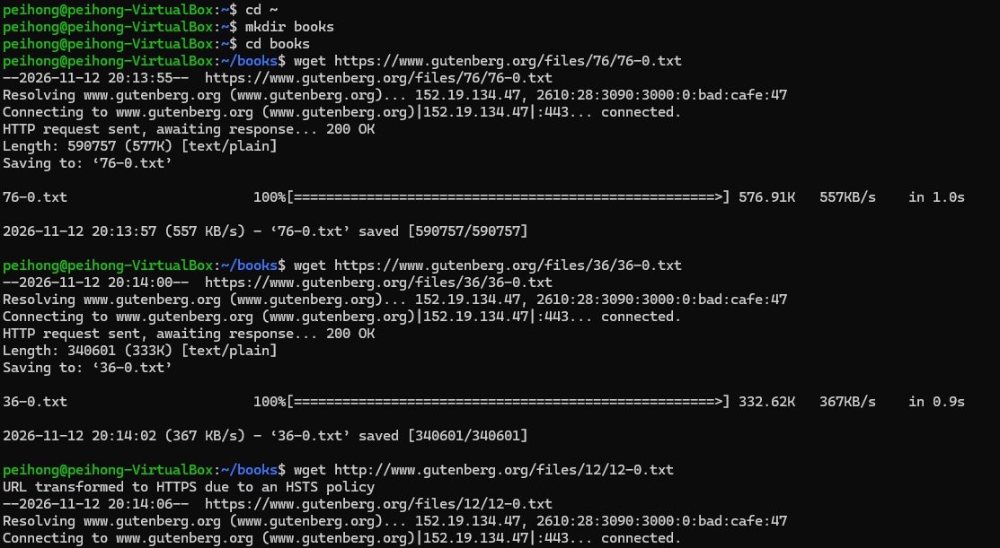

Created books.tar with tar, then compressed it with bzip2.

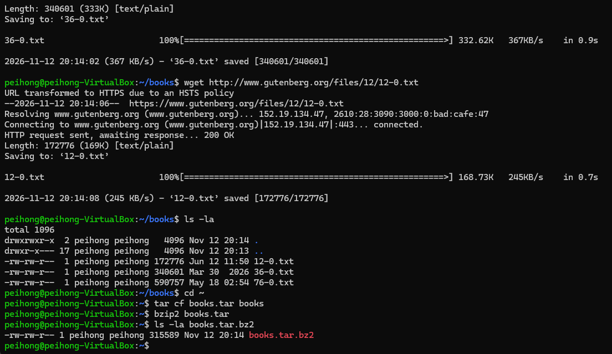

Decompressed with bunzip2 and extracted with tar -xvf. books.tar is back to 1,116,160 bytes.

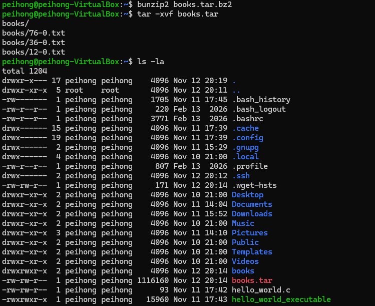

| File | Size (bytes) |
|---|---|
| 12-0.txt | 172,776 |
| 36-0.txt | 340,601 |
| 76-0.txt | 590,757 |
| Total | 1,104,134 |
| books.tar.bz2 | 315,589 |

The compressed file is about 29% of the original size (about 71% smaller), a compression ratio of roughly 3.5:1.

## Part 6 – Remote GUI and SCP (Challenges)

Challenge 2: running gnome-text-editor (gedit is not installed) over SSH only shows graphics warnings. A GUI program needs a display, which an SSH session does not provide.

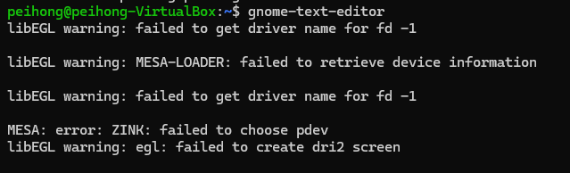

Challenge 3: copied win.ini from Windows to the VM with scp -P 2222 (100% transferred).

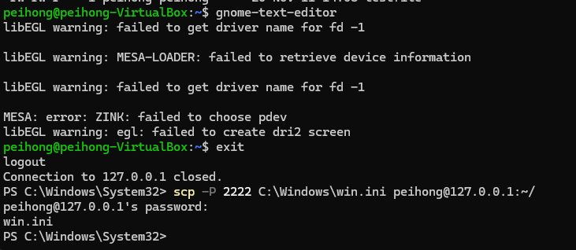

Verified the file arrived in the VM with ls -la win.ini.

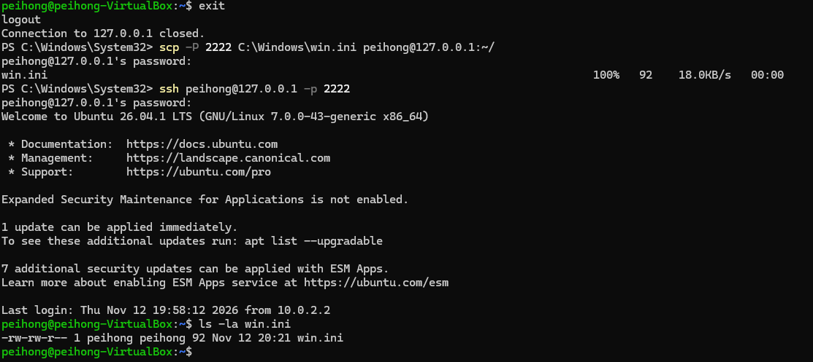

## Reflection

- What's the role of a firewall in managing services?
- A firewall uses policies to control which ports can accept incoming connections. By only allowing the ports that are needed, it reduces the risk of being hacked.
- How did SSH access deepen your understanding of Linux as a server?
- SSH lets administrators remotely control a server and check its status and problems. However, it only works through commands and cannot run GUI applications.
- Why is file compression important in server context?
- Compressing files reduces storage space and makes file transfers faster.
- How does user privilege management help secure systems?
- User permissions give each user access that matches their role. For example, finance staff can only see finance files, and HR staff can only see HR files. These are normal user accounts that cannot change other users’ permissions. In the IT department, only one or two key people should be administrators. This reduces the risk of accounts being hacked, files being leaked, and normal users damaging the system.
## AI Tools Used

I used Claude to format this document, help describe the steps from my screenshots, and translate my answers. All lab work, screenshots and ideas are my own.
