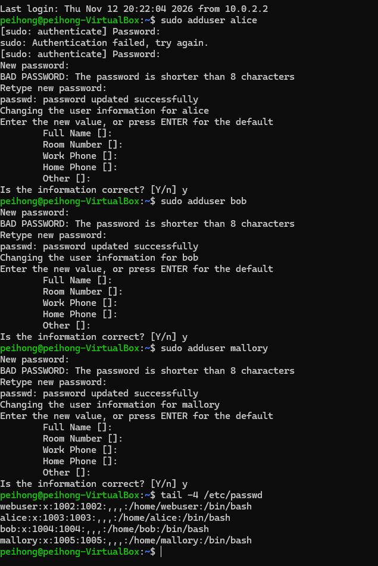
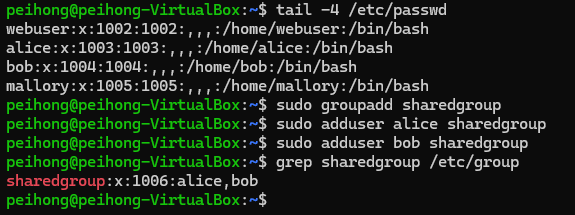
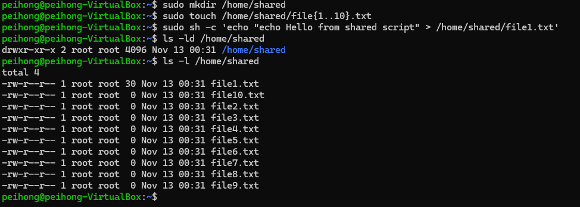
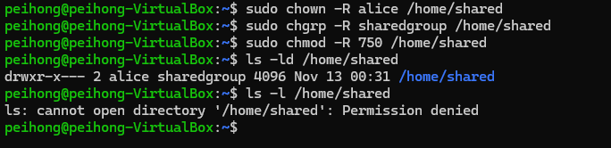
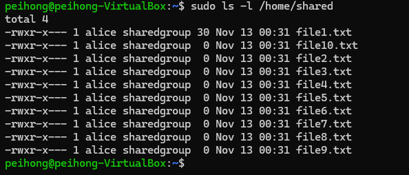
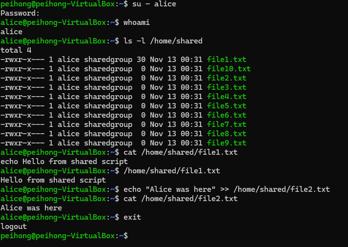
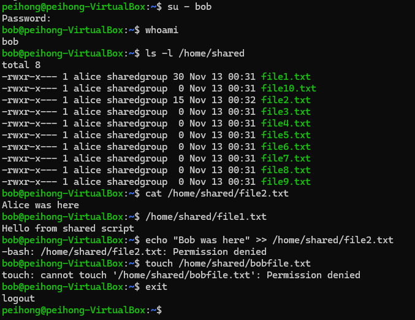
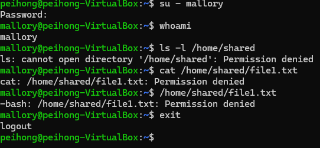
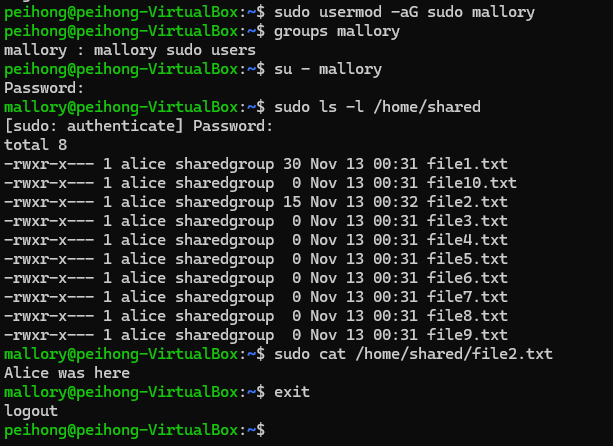
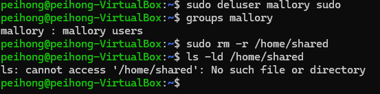

# Lab 1b-2 – Linux File Permissions and Group Access Control

| Student Name | Tsen Pei Hong |
|---|---|
| Kaplan ID | CT0375497 |
| Murdoch ID | 36431456 |
| Module | BRG-ISEA – Introduction to Server Environments and Architectures |
| Date | 13 Nov 2026 |
| Environment | Ubuntu 26.04.1 LTS on VirtualBox (accessed from Windows via SSH) |

## Goal and Design

The goal was to give three users different access to a shared folder:

| User | Required access | Gets permission as |
|---|---|---|
| Alice | Read, write, execute (rwx) | Owner |
| Bob | Read, execute only (r-x) | Group (sharedgroup) |
| Mallory | No access (---) | Others |

The lab sheet suggests chmod 770 and then 750, but if Alice and Bob are both only group members, they would always get the same permissions. To give them different access, I made Alice the owner (owner bits = 7) and Bob a group member (group bits = 5). Mallory is not in the group, so she falls under 'others' (0). One setting, chmod 750, covers all three users.

## Step 1 – Create Users

Created alice, bob and mallory with sudo adduser. /etc/passwd shows the new users with UIDs 1003, 1004 and 1005.

## Step 2 – Create and Configure the Group

Created sharedgroup and added alice and bob. /etc/group confirms the members are alice and bob only (Mallory is not included).

## Step 3 – Create the Shared Folder and 10 Files

Created /home/shared and file1.txt to file10.txt. file1.txt contains a command so it can be used to test execute permission. Before the change, everything is owned by root with -rw-r--r--, so every user (including Mallory) could read the files.

## Step 4 – Set Owner, Group and Permissions (Recursive)

Used chown -R, chgrp -R and chmod -R 750. The folder is now drwxr-x--- alice sharedgroup. My own account (peihong) gets 'Permission denied' because it is neither the owner nor in the group, which already shows the setting works.

Viewed with sudo: every file is now -rwxr-x--- alice sharedgroup.

## Step 5 – Verify Access as Each User

Alice: can read (cat), execute (file1.txt prints 'Hello from shared script') and write to file2.txt.

Bob: can read and execute, but writing to file2.txt and creating a new file both give 'Permission denied'.

Mallory: listing the folder, reading and executing all give 'Permission denied'.

| User | Read | Execute | Write |
|---|---|---|---|
| Alice | Yes | Yes | Yes |
| Bob | Yes | Yes | No |
| Mallory | No | No | No |

## Step 6 – Challenge: Give Mallory Sudo Access

Added mallory to the sudo group (groups mallory shows sudo). Using sudo, Mallory could list the folder and read file2.txt ('Alice was here'), even though the file permissions block her. Sudo bypasses normal file permissions.

## Step 7 – Remove Sudo and Clean Up

Removed mallory from the sudo group (groups mallory no longer shows sudo) and deleted /home/shared recursively. ls confirms the folder no longer exists.

## Deliverables

| # | Deliverable | Where |
|---|---|---|
| 1 | Three users created | Step 1 |
| 2 | Group created and configured | Step 2 |
| 3 | 'shared' directory created in /home/ | Steps 3–4 |
| 4 | Ten files created | Step 3 |
| 5 | Permissions assigned properly | Step 4 |
| 6 | Access verified as each user | Step 5 |
| 7 | Use of chmod/chown/chgrp -R | Step 4 |
| 8 | Mallory added to sudoers | Step 6 |
| 9 | Effect of sudo access tested | Step 6 |
| 10 | Folder clean-up performed | Step 7 |

## Reflection

**1. How do Linux permissions differ from Windows ACL?**

Linux permissions are simple, with only three types: read, write and execute. Windows ACL can be more complex, for example, it can deny access to specific users.

**2. What's the effect of chmod 770 vs 750?**

With 770, both Alice and Bob can read, write and execute, while Mallory gets 0 and cannot access anything. With 750, Alice stays the same, but Bob changes from 7 to 5, so he can only read and execute but cannot write. Mallory still gets 0.

**3. What is the risk of adding users to the sudo group?**

Users with sudo access might make a mistake by accident and stop the company's systems from working properly.

**4. Why is it important to verify with su and whoami?**

Because it confirms which account we are currently logged in as, which verifies our identity before testing.

## AI Tools Used

I used Claude to format this document, help describe the steps from my screenshots, and translate my reflection answers from Chinese to English. All lab work, screenshots and ideas are my own.
