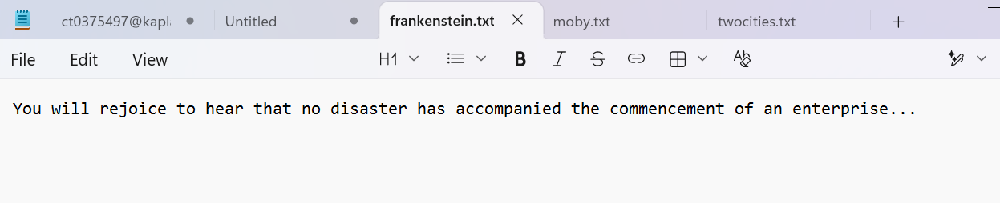
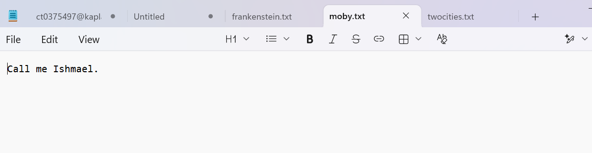
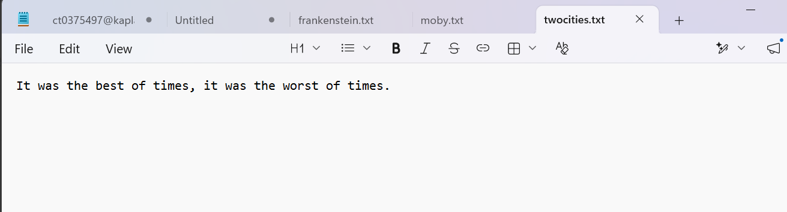
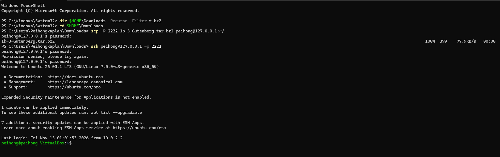
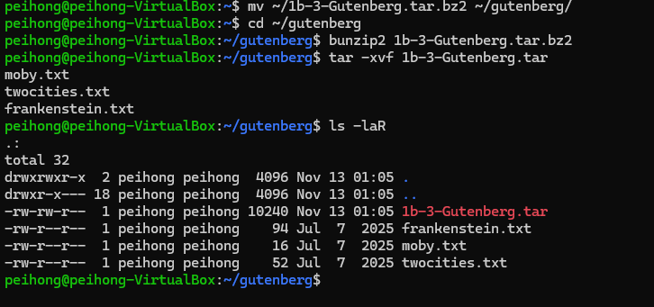
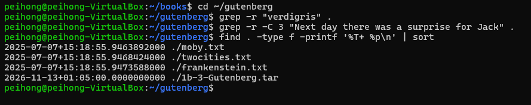
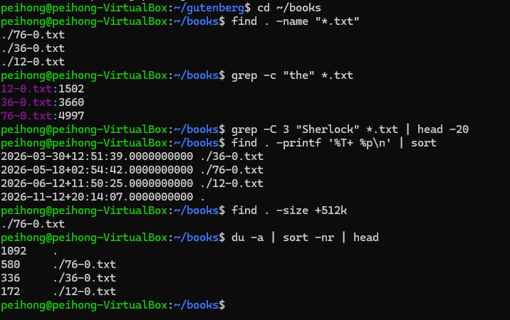
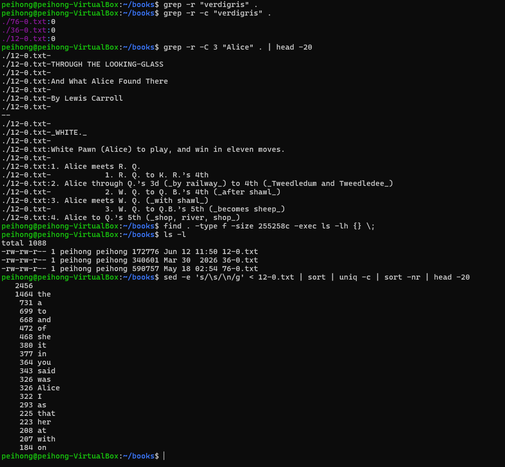
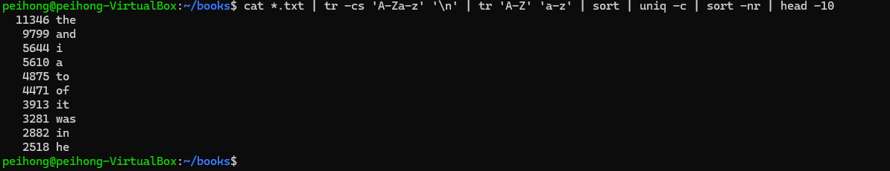

# Lab 1b-3 – File Search, Analysis & Archiving in Linux

| Student Name | Tsen Pei Hong |
|---|---|
| Kaplan ID | CT0375497 |
| Murdoch ID | 36431456 |
| Module | BRG-ISEA – Introduction to Server Environments and Architectures |
| Date | 13 Nov 2026 |
| Environment | Ubuntu 26.04.1 LTS on VirtualBox (accessed from Windows via SSH) |

## Note on the Archive

The provided 1b-3-Gutenberg.tar.bz2 only contains 3 small text files (16, 52 and 94 bytes). Each file has only the first line of a book. The files needed for the questions (e.g. 1107.txt, the 255258-byte file) are not in the archive. Because of this, I ran every command on the archive first, and then also practised the same commands on 3 full Project Gutenberg books in ~/books (from Lab 1b-1) so the outputs are meaningful.

## Step 1 – Copy the Archive into the VM

Used scp from Windows PowerShell (port 2222) to copy the archive into the VM, then logged in with SSH.

## Step 2 – Extract the Archive

Moved the archive into ~/gutenberg, then used bunzip2 to decompress it to a .tar file and tar -xvf to extract it. ls -laR lists the 3 extracted files: frankenstein.txt, moby.txt and twocities.txt.

## Step 3 – Search the Archive

Searched the archive for 'verdigris' and for 'Next day there was a surprise for Jack' — both return nothing. find with -printf '%T+ %p' and sort lists the files by date: moby.txt, twocities.txt, then frankenstein.txt (3rd oldest).

## Step 4 – Search Commands on Full Books (~/books)

find . -name "*.txt" lists the 3 books. grep -c "the" counts matching lines in each book. find -printf with sort lists files by date. find -size +512k finds 76-0.txt (the only file over 512 KB). du -a | sort -nr | head shows the largest files first.

grep -r -c "verdigris" returns 0 for all books. grep -r -C 3 "Alice" shows 3 lines of context before and after each match. find -size 255258c finds no file of that exact size, and ls -l shows the real sizes. sed splits text into one word per line, then sort | uniq -c | sort -nr counts the most common words in 12-0.txt.

## Step 5 – Word Frequency Across All Books

tr splits all books into words and changes them to lower case, then sort | uniq -c | sort -nr | head -10 shows the 10 most common words. 'the' is the most common (11,346 times).

## Answers to the 5 Questions

| # | Question | Answer |
|---|---|---|
| 1 | How many times does 'verdigris' appear? | 0 (not found in the provided archive) |
| 2 | Surname of the author of 1107.txt | Cannot be answered – 1107.txt is not in the archive |
| 3 | Author of the file that is exactly 255258 bytes | Cannot be answered – no file of this size in the archive |
| 4 | Filename with the 3rd oldest creation date | frankenstein.txt |
| 5 | Word after 'Next day there was a surprise for Jack' | Cannot be answered – text not found in the archive |

## Deliverables

| # | Deliverable | Where |
|---|---|---|
| 1 | Archive extracted successfully | Step 2 |
| 2 | File listing of extracted directory | Step 2 |
| 3 | Filename search | Step 4 |
| 4 | Text search via grep | Steps 3–4 |
| 5 | Contextual text search (grep -C 3) | Steps 3–4 |
| 6 | Date-based file search | Steps 3–4 |
| 7 | Size-based file search (255258c and +512k) | Step 4 |
| 8 | Largest files found (du -a) | Step 4 |
| 9 | Text frequency analysis (sed / uniq) | Steps 4–5 |
| 10 | Answers to questions | Answers section |

## Reflection

**1. Which command-line tool was the most useful in solving the questions?**

grep -r "string" /path. Most users remember the content of a document, so I only need to type a few words from it to find the file.

**2. How might these search tools help in cybersecurity investigations?**

They can help find out which files are dangerous. For example, I can check for unusually large folders, and see if any strange software or files were installed in them.

**3. How could scripting improve repetitive search tasks?**

Scripts can do a large number of searches quickly, with fewer mistakes than doing it manually.

**4. What limitations did you encounter using grep and find?**

find can return too many results, and grep does not support encodings such as UTF-16 by default.

## AI Tools Used

I used Claude to format this document, help describe the steps from my screenshots, and translate my reflection answers from Chinese to English. All lab work, screenshots and ideas are my own.
