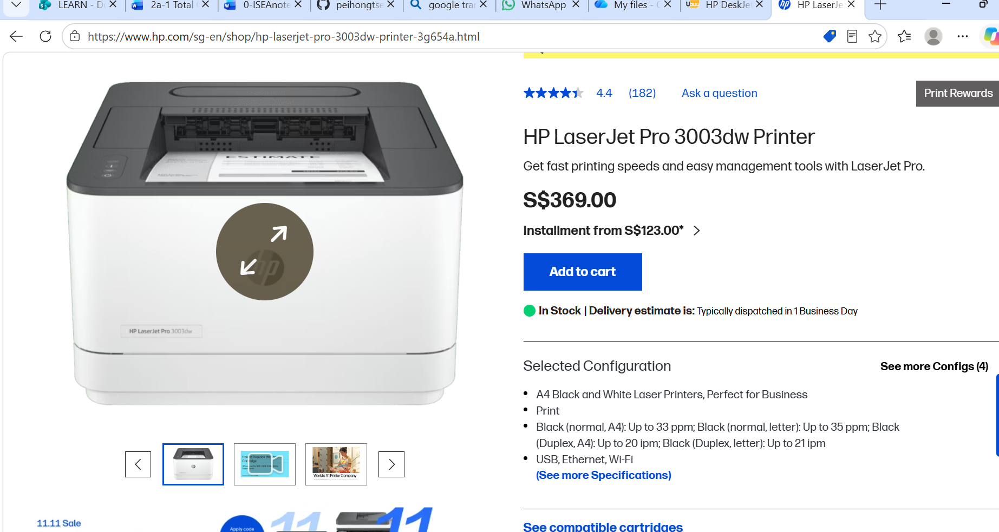
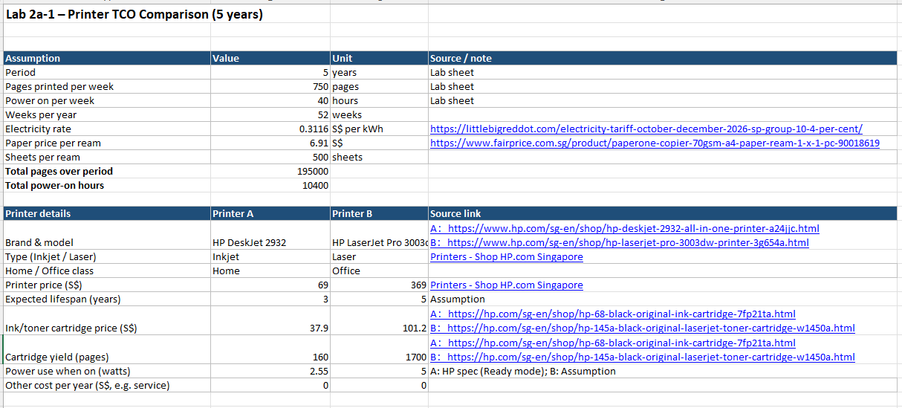
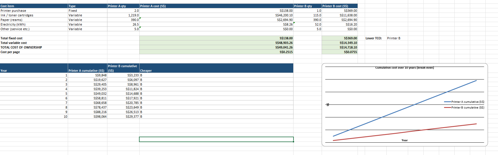

# Lab 2a-1 – Total Cost of Ownership (TCO) Analysis

| Student Name | Tsen Pei Hong |
|---|---|
| Kaplan ID | CT0375497 |
| Murdoch ID | 36431456 |
| Module | BRG-ISEA – Introduction to Server Environments and Architectures |
| Date | 15 Nov 2026 |
| Tool | Microsoft Excel |

## 1. Printer Models Chosen

|  | Model | Type | Class |
|---|---|---|---|
| A | HP DeskJet 2932 All-in-One | Inkjet | Entry-level home / personal |
| B | HP LaserJet Pro 3003dw | Mono laser | Office / small workgroup |

## 2. Cost Assumptions

- Comparison period: 5 years (52 weeks per year)
- Pages printed per week: 750 (total 195,000 pages)
- Printer power on: 40 hours per week (total 10,400 hours)
- Black-and-white printing only (colour ink not included)
- Power use is based on Ready mode, because 750 pages only need about 20 minutes of printing per week. Printer A: 2.55 W (HP spec). Printer B: 5 W (assumption, not listed on HP site)
- Printer lifespan (assumption): inkjet 3 years, laser 5 years. So Printer A must be bought twice in 5 years
- Electricity: S$0.3116 per kWh (SP Group, Oct–Dec 2026, incl. 9% GST)
- Paper: S$6.91 per ream of 500 sheets
- Cartridge yield: HP 68 Black = 160 pages; HP 145A = 1,700 pages
- All prices are from Singapore websites in Nov 2026 and include GST
## 3. Expense Items

| Item | Type |
|---|---|
| Printer purchase | Fixed |
| Ink / toner cartridges | Variable |
| Paper | Variable |
| Electricity | Variable |
| Other (service) | Variable – set to S$0 |

## 4. Unit Costs and Sources

| Item | Unit price | Source |
|---|---|---|
| Printer A – HP DeskJet 2932 | S$69.00 | hp.com/sg-en/shop/hp-deskjet-2932-all-in-one-printer-a24jjc.html |
| Printer B – HP LaserJet Pro 3003dw | S$369.00 | hp.com/sg-en/shop/hp-laserjet-pro-3003dw-printer-3g654a.html |
| HP 68 Black ink (160 pages) | S$37.90 | hp.com/sg-en/shop/hp-68-black-original-ink-cartridge-7fp21ta.html |
| HP 145A toner (1,700 pages) | S$101.20 | hp.com/sg-en/shop/hp-145a-black-original-laserjet-toner-cartridge-w1450a.html |
| A4 paper, PaperOne 70gsm, 500 sheets | S$6.91 | fairprice.com.sg/product/paperone-copier-70gsm-a4-paper-ream-1-x-1-pc-90018619 |
| Electricity per kWh | S$0.3116 | littlebigreddot.com/electricity-tariff-october-december-2026-sp-group-10-4-per-cent/ |

Printer B product page (price S$369):

## 5. Spreadsheet Calculation (TCO Model)

The spreadsheet uses formulas: Quantity × Unit price = Total per item. Quantities are calculated from the assumptions, for example cartridges = total pages ÷ cartridge yield (rounded up).

|  | Printer A (Inkjet) | Printer B (Laser) |
|---|---|---|
| Total fixed cost | S$138.00 | S$369.00 |
| Total variable cost | S$48,903.26 | S$14,349.10 |
| Total Cost of Ownership (5 years) | S$49,041.26 | S$14,718.10 |

## 6. Cost per Page

| Printer | Calculation | Cost per page |
|---|---|---|
| Printer A (Inkjet) | S$49,041.26 ÷ 195,000 | S$0.2515 |
| Printer B (Laser) | S$14,718.10 ÷ 195,000 | S$0.0755 |

## 7. Break-even Analysis

The table and chart show the cumulative cost for 1 to 10 years. Printer B is cheaper in every year, so the two lines never cross within the period. The break-even point happens very early:

- Extra purchase cost of laser: S$369 − S$69 = S$300
- Ink saving per page: S$0.2369 − S$0.0595 = about S$0.18
- Break-even: S$300 ÷ S$0.18 ≈ 1,700 pages, which is under 3 weeks at 750 pages per week
## 8. Reflection

**1. Which printer has lower TCO and why?**

Printer B (HP LaserJet Pro 3003dw) has the lower 5-year TCO: S$14,718 compared with S$49,041. The main reason is the cheaper ink per page (S$0.075 vs S$0.25). The inkjet needs 1,219 cartridges in 5 years, while the laser needs only 115.

**2. Would the choice change if only 5 pages per week were printed?**

Yes. At 5 pages per week (1,300 pages in 5 years), the cost is almost the same: about S$508 for the inkjet and S$507 for the laser. At low volume, the purchase price matters more than the ink cost.

**3. What other qualitative or intangible factors could be considered?**

Print speed, size, noise, Wi-Fi and warranty. A good Wi-Fi connection is needed for us to be able to print. If the network side is not done well, the printer cannot be used.

**4. For a large workgroup printer, what cost/performance specs would you prioritise?**

Low cost per page, and network and security features. A big company uses a lot of paper, so it should choose the option with the lower running cost. A big company also needs security because it is worried about data leaks, as staff may print important documents on the printer.

**5. Estimate the break-even time point where both printers cost the same.**

About 1,700 pages. At 750 pages per week, this is less than 3 weeks. After that, the laser printer is always cheaper.

## AI Tools Used

I used Claude to create the spreadsheet template, help me find prices and sources, suggest answer options for the reflection, format this document, and translate my reasons from Chinese to English. I checked all the numbers and chose the answers myself, and the reasons are my own.
