# Lab 2a-2 – Cloud Web Server Deployment with Amazon EC2

| Student Name | Tsen Pei Hong |
|---|---|
| Kaplan ID | CT0375497 |
| Murdoch ID | 36431456 |
| Module | BRG-31-ISEA – Introduction to Server Environments and Architectures |
| Date | 15 Nov 2026 |

## Overview

I launched an Ubuntu server on AWS EC2, opened the firewall ports, connected with an SSH key, installed Apache, and served my own web page and a PDF file. I also set up a budget alert to control cost.

| Cloud provider | AWS (Free plan, US$100 credit) |
|---|---|
| Region | Asia Pacific (Sydney) ap-southeast-2 |
| Instance | isea-web – t3.micro (2 vCPU, 1 GiB RAM), 8 GiB gp3 |
| OS image | Ubuntu Server 24.04 LTS (Free tier eligible) |
| Public IP | 3.26.212.44 |
| Security group | ssh-and-web |
| Key pair | isea-key.pem (RSA) |

Note: the lab sheet says Ubuntu 20.04. I used 24.04 LTS because it is the current supported LTS version offered by AWS.

## Steps

### Step 1 – Budget alert (Deliverable 10)

Before launching anything, I checked the billing page (free plan, S$0 due) and created a Zero-spend budget, which emails me if spending goes over US$0.01.

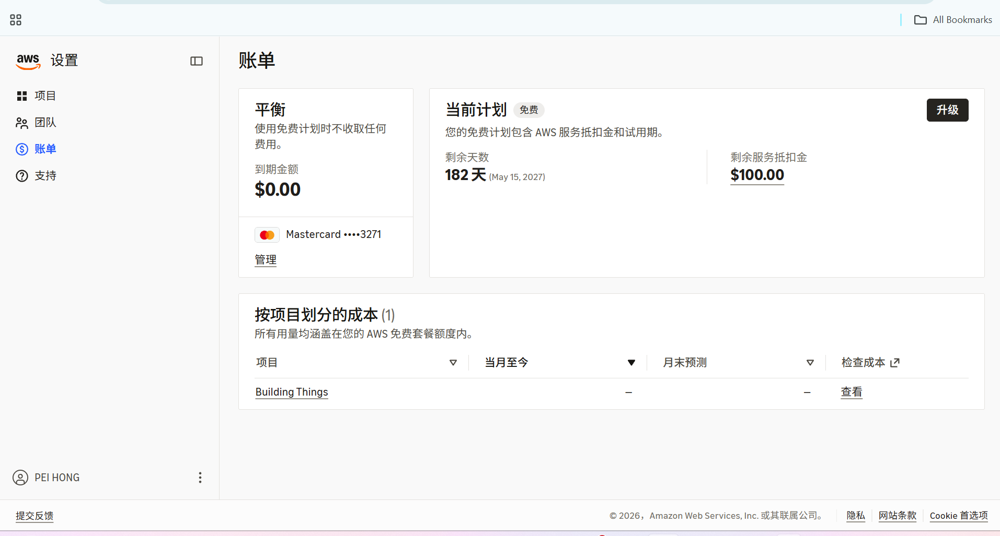

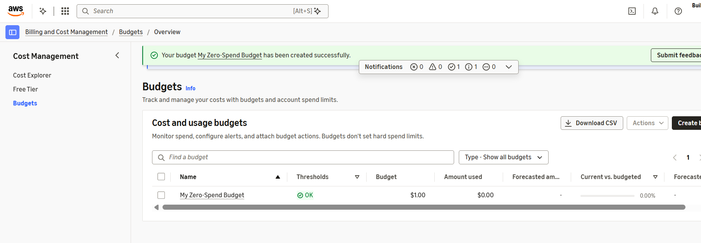

### Step 2 – Choose the OS image and instance type

Ubuntu Server 24.04 LTS and t3.micro, both Free tier eligible.

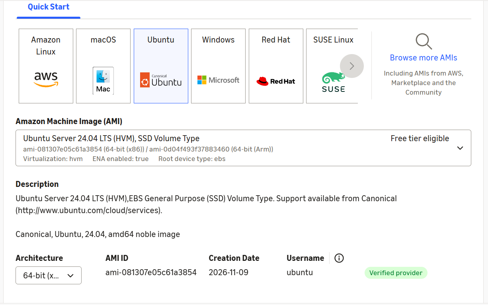

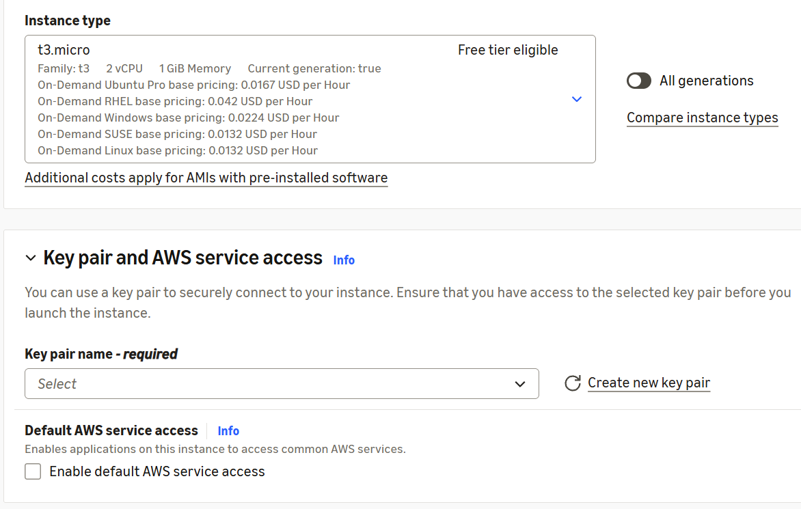

### Step 3 – Create the key pair

Created an RSA key pair in .pem format for OpenSSH. The private key can only be downloaded once.

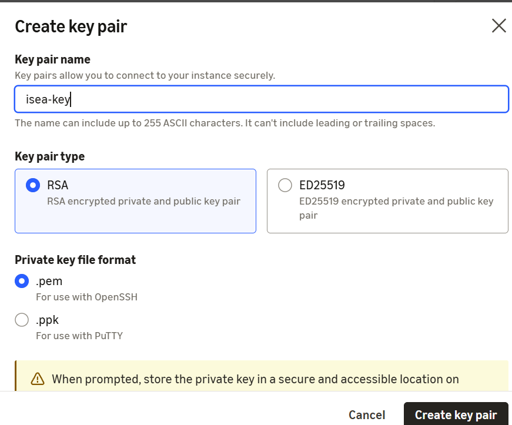

### Step 4 – Security group (Deliverable 2)

Created the security group 'ssh-and-web' allowing SSH (22) and HTTP (80). Later I added HTTPS (443) for the SSL lab and All ICMP so ping works.

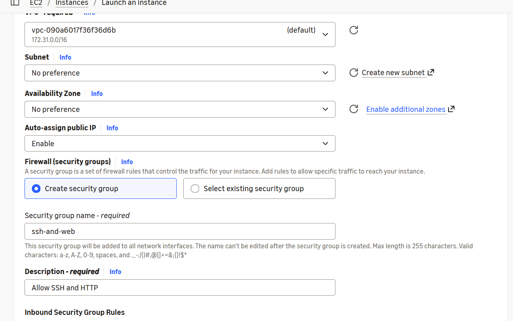

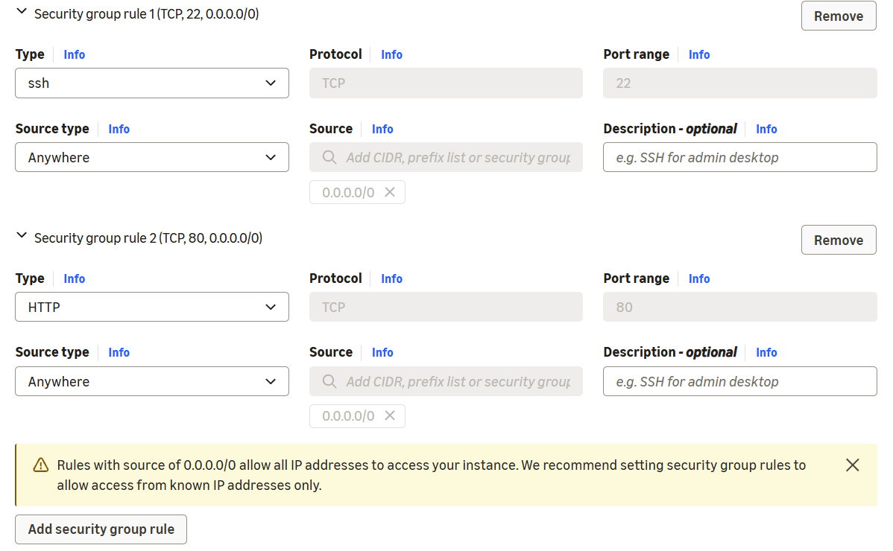

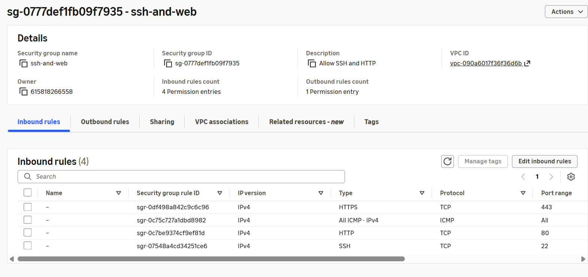

### Step 5 – Instance running (Deliverable 1)

The instance launched successfully and passed 3/3 status checks.

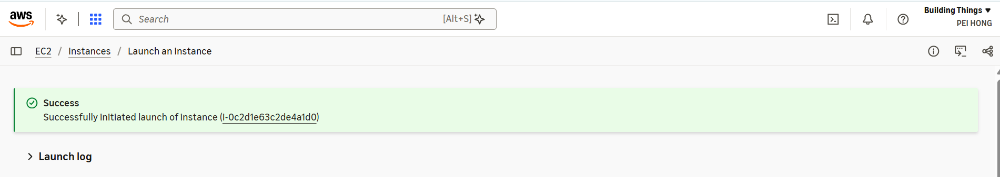

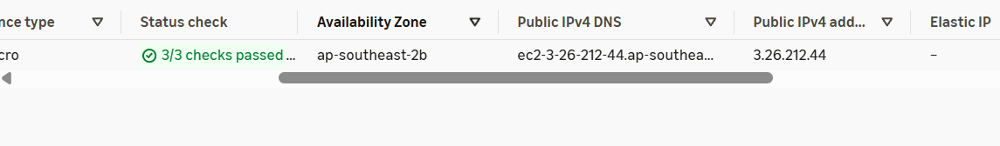

### Step 6 – SSH with the key (Deliverable 3)

Connected from Windows PowerShell using the .pem key. No password was needed.

PS C:\Users\Peihongkaplan\Downloads> ssh -i isea-key.pem ubuntu@3.26.212.44
The authenticity of host '3.26.212.44' can't be established.
Are you sure you want to continue connecting (yes/no)? yes
Welcome to Ubuntu 24.04.5 LTS (GNU/Linux 7.0.0-1014-aws x86_64)
  IPv4 address for ens5: 172.31.34.111
ubuntu@ip-172-31-34-111:~$

### Step 7 – Install Apache and test (Deliverable 4)

Ran sudo apt update and sudo apt install apache2 -y. Then opened http://3.26.212.44 in the browser and saw the Apache default page.

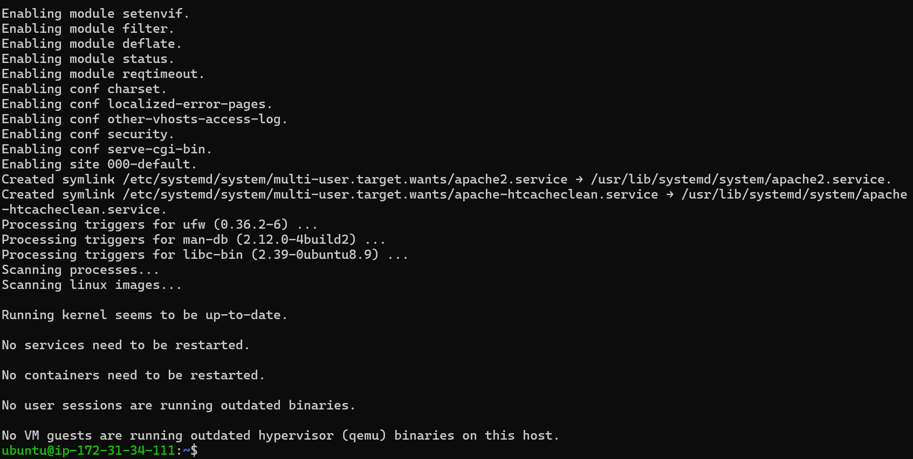

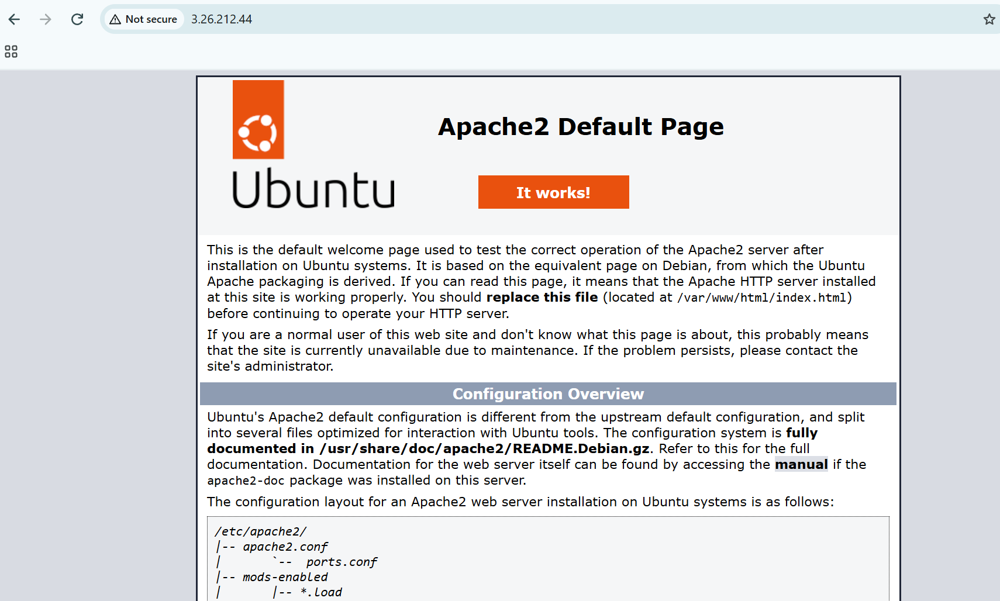

### Step 8 – Ping test

Ping did not work at first because the security group did not allow ICMP. After adding the ICMP rule, ping replied. The time was about 210 ms because the server is in Sydney.

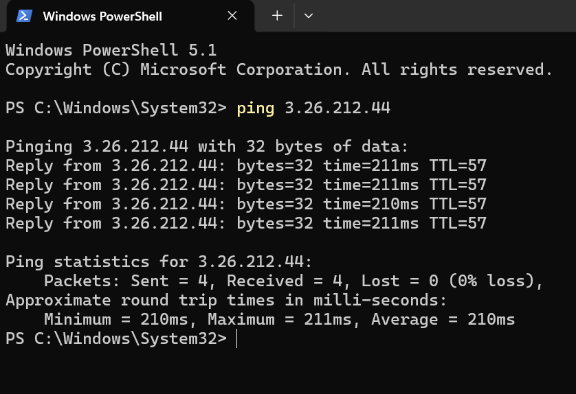

### Step 9 – Download a file with wget and copy to web root (Deliverables 6, 7)

Downloaded EECS-2009-28.pdf with wget into /home/ubuntu, then used sudo cp to copy it into /var/www/html. The copy in the web root is owned by root with permission -rw-r--r--, so everyone (including Apache) can read it.

wget https://www2.eecs.berkeley.edu/Pubs/TechRpts/2009/EECS-2009-28.pdf
sudo cp EECS-2009-28.pdf /var/www/html/
ls -l ~/EECS-2009-28.pdf /var/www/html

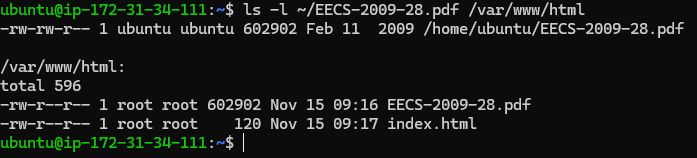

### Step 10 – Edit index.html with a link (Deliverables 5, 9)

Replaced the default page with my own content using nano, including a hyperlink to the PDF.

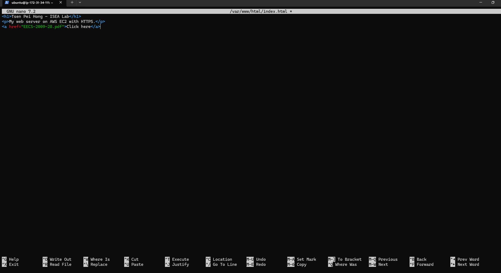

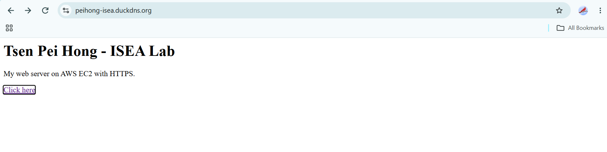

### Step 11 – PDF accessible in browser (Deliverable 8)

Clicking the link opens the PDF from my server.

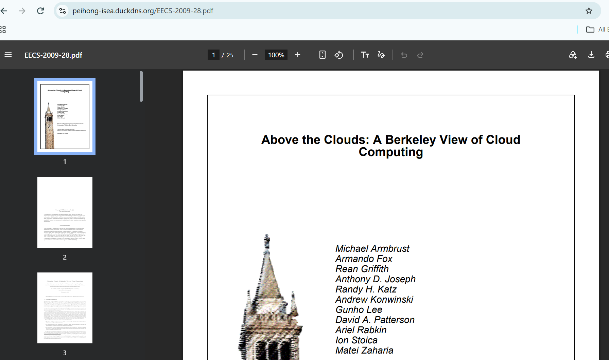

## Deliverables Checklist

| # | Deliverable | Where |
|---|---|---|
| 1 | EC2 instance running | Step 5 |
| 2 | Security group configured | Step 4 |
| 3 | SSH access | Step 6 |
| 4 | Apache installed and tested | Step 7 |
| 5 | Custom index.html | Step 10 |
| 6 | File downloaded with wget | Step 9 |
| 7 | File copied to web root | Step 9 |
| 8 | PDF accessible via browser | Step 11 |
| 9 | Link in HTML page | Step 10 |
| 10 | Budget monitoring | Step 1 |
| 11 | Instance stopped (optional) | Not done yet – kept running for the DNS/SSL labs |

## Reflection

**1. What were the benefits of cloud deployment over local virtualisation?**

A cloud server is more stable than VirtualBox because it runs 24 hours a day. If I use VirtualBox on my computer and the computer shuts down or loses internet, the whole server goes offline.

**2. How does Apache serve files, and how did you verify this?**

I tested with curl -I http://peihong-isea.duckdns.org, and it showed that the server is Apache.

**3. What did you learn about file ownership and permissions?**

sudo lets you temporarily use the root (super administrator) account to make changes.

**4. What risks are associated with leaving instances running?**

The server would not get updates, and it is easier for hackers to attack because port 22 stays open.

**5. How would you explain the difference between DNS and /etc/hosts to a client?**

For example, DNS is like a public toilet, and /etc/hosts is like the toilet in your own home. A public toilet is for everyone, and everyone knows where it is. The toilet at home is only for your family, and other people need to ask where it is.

## AI Tools Used

I used Claude to guide me through the steps, suggest the commands and the index.html content, give hints for the reflection questions, format this document, and translate my answers from Chinese to English. I did all the lab work and screenshots myself, and the reflection answers are my own ideas.
