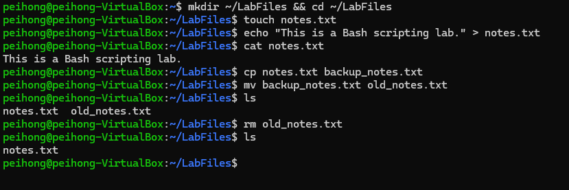
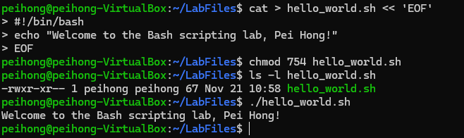
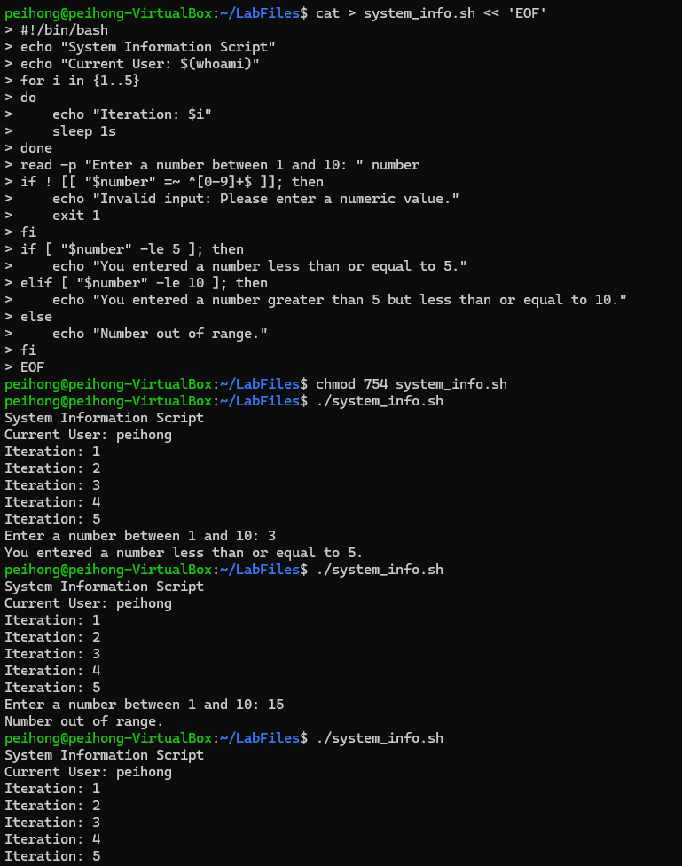
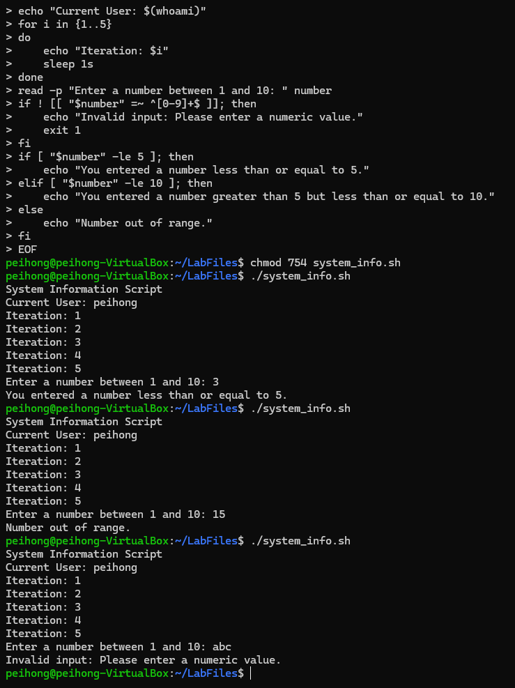
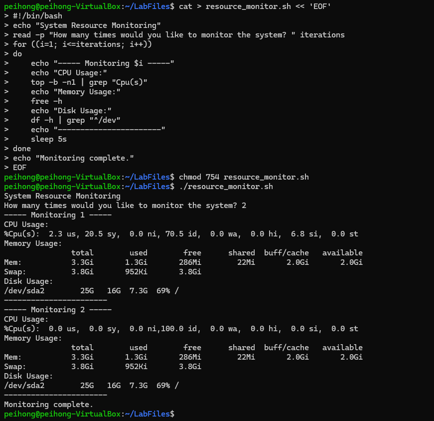
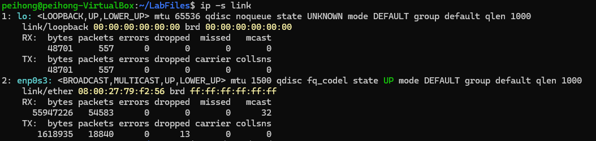

# Lab 2b-1 – Introduction to Bash Scripting & System Automation

| Student Name | Tsen Pei Hong |
|---|---|
| Kaplan ID | CT0375497 |
| Murdoch ID | 36431456 |
| Module | BRG-31-ISEA – Introduction to Server Environments and Architectures |
| Date | 21 Nov 2026 |

## Overview

I practised basic file commands, then wrote three Bash scripts on my Ubuntu VM: a hello world script, a script with a loop and if/elif/else, and a system resource monitoring script.

Notes: the lab sheet uses chmod 777. I used chmod 754 (as shown in class), so only the owner can edit the script, the group can read and run it, and others can only read it. The lab sheet's system_info.sh uses 'continue' outside a loop, which causes an error, so I used 'exit 1' instead. I created the scripts with cat and a heredoc instead of nano.

## Steps

### Part 1 – File and directory operations (Deliverable 1)

mkdir, touch, echo >, cat, cp, mv, ls and rm.

### Part 2 – hello_world.sh (Deliverable 3)

Script with #!/bin/bash and a personalised echo message, made executable with chmod 754 (rwxr-xr--).

### Part 3 – system_info.sh with loop and conditionals (Deliverable 5)

Shows the current user with whoami, loops from 1 to 5, then checks the number entered. I tested three inputs: 3 (≤ 5), 15 (out of range) and abc (invalid input).

### Part 4 – resource_monitor.sh (Deliverable 7)

Asks how many times to check, then shows CPU (top), memory (free -h) and disk (df -h) usage every 5 seconds.

### Extra – network usage with ip -s link

For Reflection 12, I tested ip -s link, which shows the bytes and packets received (RX) and sent (TX) on each network interface.

## Deliverables Checklist

| # | Deliverable | Where |
|---|---|---|
| 1 | Directory and file operations | Part 1 |
| 2 | Reflection: file system commands | Reflection 1–3 |
| 3 | Basic script created and run | Part 2 |
| 4 | Reflection: script basics | Reflection 4–6 |
| 5 | Loop and conditional script | Part 3 |
| 6 | Reflection: loops and conditionals | Reflection 7–9 |
| 7 | System monitoring script | Part 4 |
| 8 | Reflection: monitoring automation | Reflection 10–12 |

## Reflection

**1. What command did you use to create a directory?**

mkdir

**2. How can you view file content without a GUI editor?**

cat filename.txt

**3. What is the difference between cp and mv?**

cp copies a file, and mv moves it (or renames it).

**4. What is chmod +x (or 754) for?**

With 754, 7 means the owner can read, write and execute; 5 means group members can read and execute; 4 means others can read only.

**5. Why is #!/bin/bash used?**

It tells the system to run the script with the Bash shell.

**6. How can you personalise script output?**

Use echo or printf, for example: echo "System Information Script".

**7. How does the for loop work?**

You give it a range of numbers and it repeats for each one. It runs from 1 to 5 automatically, and sleep 1s pauses for one second each time.

**8. What happens if the number is greater than 10?**

The script shows "Number out of range."

**9. How could invalid input be handled more gracefully?**

Use a while loop that shows an error and stays in the loop, asking for input again until the user enters valid data.

**10. What does free -h show?**

It shows memory and swap information.

**11. Why is automation important for admins?**

Because problems can be found early, so the server does not suddenly crash or become inaccessible.

**12. How can the script be modified to monitor network usage?**

Add ip -s link inside the loop.

## AI Tools Used

I used Claude to guide me through the steps and commands, fix an error in the lab sheet's script, give hints for the reflection questions, format this document, and translate my answers from Chinese to English. I ran all the scripts and took the screenshots myself, and the reflection answers are my own.
