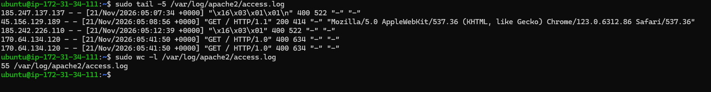
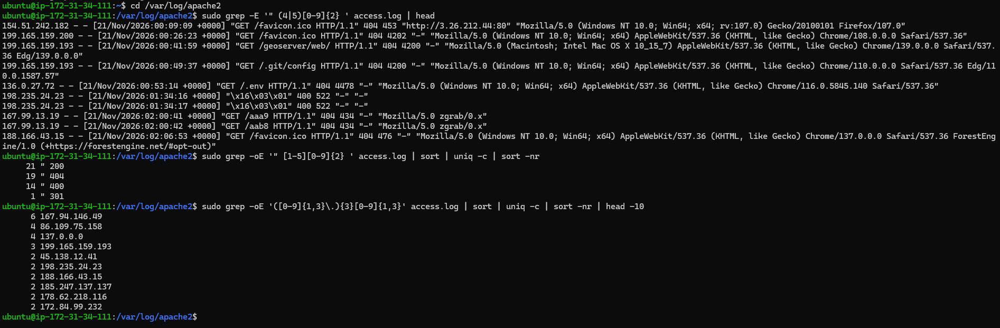
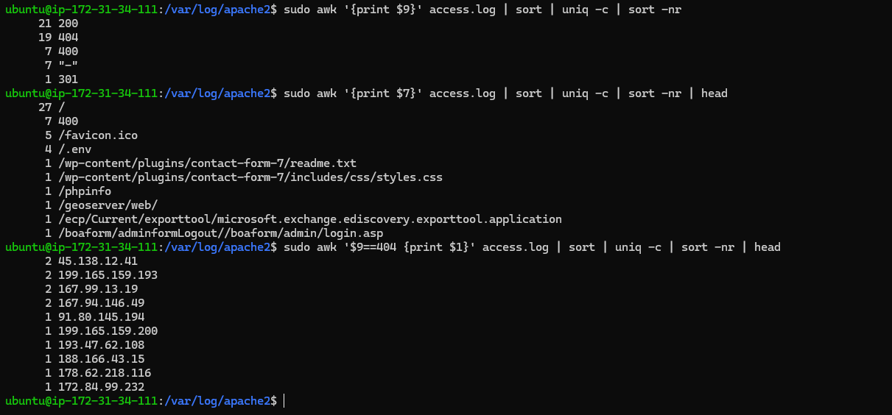
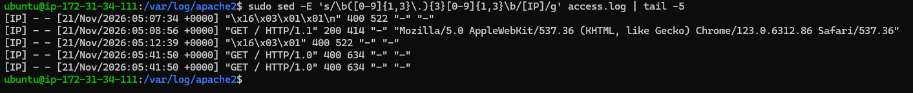
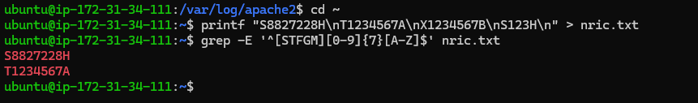
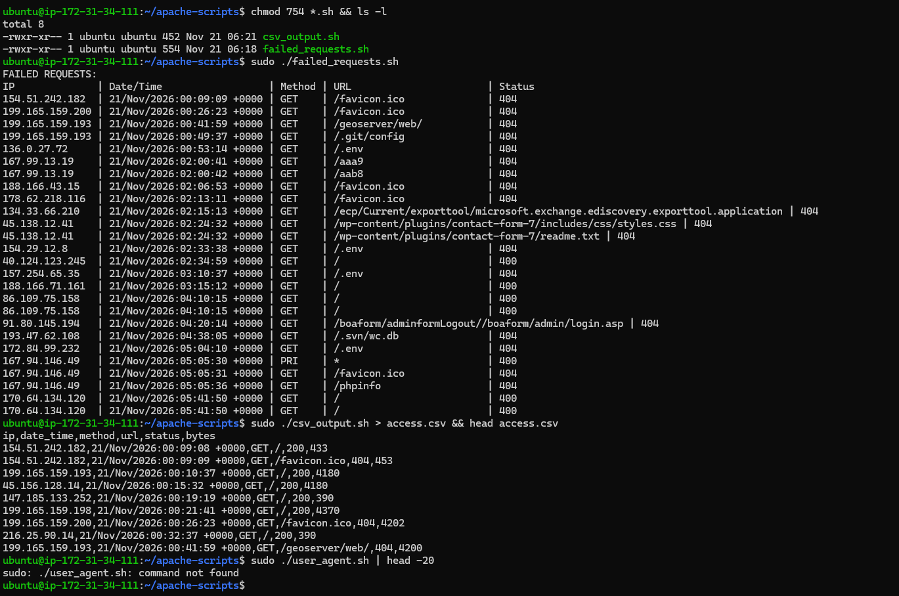
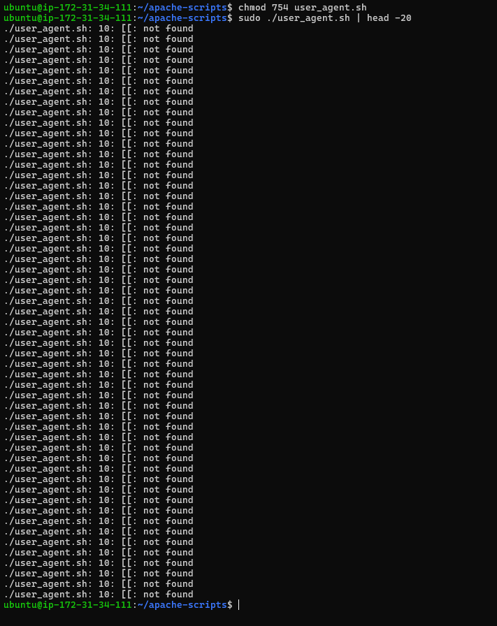
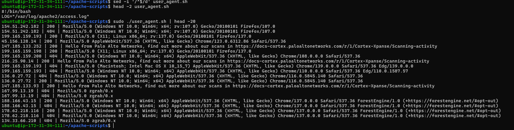

# Lab 2b-2 / 2b-3 – Regex, AWK and Apache Log Analysis

| Student Name | Tsen Pei Hong |
|---|---|
| Kaplan ID | CT0375497 |
| Murdoch ID | 36431456 |
| Module | BRG-31-ISEA – Introduction to Server Environments and Architectures |
| Date | 21 Nov 2026 |

## Overview

I used grep with regular expressions, awk and sed to search and filter the Apache access log on my AWS EC2 server (peihong-isea.duckdns.org), then wrote three Bash scripts that use regex to parse the log. Because the server is on the internet, the log contains real traffic from unknown IPs and bots, not just my own visits.

| Server | AWS EC2 Ubuntu 24.04 (from Lab 2a-2) |
|---|---|
| Log file | /var/log/apache2/access.log (55 lines, about 6 days of traffic) |
| Tools | grep -E, awk, sed, Bash [[ =~ ]] with BASH_REMATCH |

## Part A – Lab 2b-2: Regex, grep, awk and sed

### Step 1 – Look at the log

tail shows the latest requests; wc -l counts the lines.

### Step 2 – grep with regex

(1) Failed requests (4xx/5xx), (2) count of each status code, (3) top 10 IP addresses.

### Step 3 – awk by field

awk splits each line by spaces: $9 is the status code, $7 is the URL and $1 is the IP. The commands show status counts, the most requested URLs and which IPs caused 404 errors.

### Step 4 – sed to mask IP addresses

Replaces every IP with [IP], useful when sharing logs without exposing personal data.

### Step 5 – Test a regex on Singapore NRIC format

^[STFGM][0-9]{7}[A-Z]$ matches only the two valid formats (S8827228H, T1234567A).

## Part B – Lab 2b-3: Apache log scripts

### Step 6 – Failed requests and CSV output

failed_requests.sh lists every request with status 400 or above. csv_output.sh converts the log into CSV so it can be opened in Excel.

### Step 7 – Problem: [[: not found

When I pasted user_agent.sh, an empty first line was added, so #!/bin/bash was not on line 1. The system ran the script with sh instead of bash, and sh does not understand [[. I removed the empty lines with sed -i '/^$/d' and ran it again.

### Step 8 – User-agent script

Shows the IP, status and user-agent of each request.

## What the log showed

- Bots scanned the server for secret or vulnerable files: /.env, /.git/config, /.svn/wc.db, /phpinfo, WordPress plugins, a Microsoft Exchange path and a router admin page (/boaform/admin/login.asp). All returned 404 because these files do not exist.
- Some scanners identify themselves (Palo Alto Networks Cortex Xpanse, zgrab, ForestEngine). Many others pretend to be normal Chrome or Firefox browsers, so the user-agent can be faked.
- Several 400 errors came from \x16\x03\x01 requests, which is an HTTPS (TLS) handshake sent to the HTTP port.
- grep counted 14 errors with status 400, but awk counted only 7. The broken TLS lines do not have the normal format, so awk's $9 field is '-' for them.
- The regex for IP addresses also matched 137.0.0.0, which is not an IP but part of the user-agent 'Chrome/137.0.0.0'. A regex that is too loose gives false matches.
## Reflection

**1. The server was scanned by many bots within six days. What did you learn?**

If a server is only used for training, do not put any sensitive information on it, in case it gets hacked.

**2. grep + regex or awk – which is better and why?**

grep is a carpet search (it searches everything), while awk is a precise search (it looks at a specific field).

**3. How can log analysis be used at work?**

A log is like a diary. It records what happened, so we can check it when there is a problem and see who did it.

## AI Tools Used

I used Claude to guide me through the commands and scripts, explain what the log results meant, help fix the [[: not found error, format this document, and translate my answers from Chinese to English. I ran all the commands and scripts and took the screenshots myself, and the reflection answers are my own.
