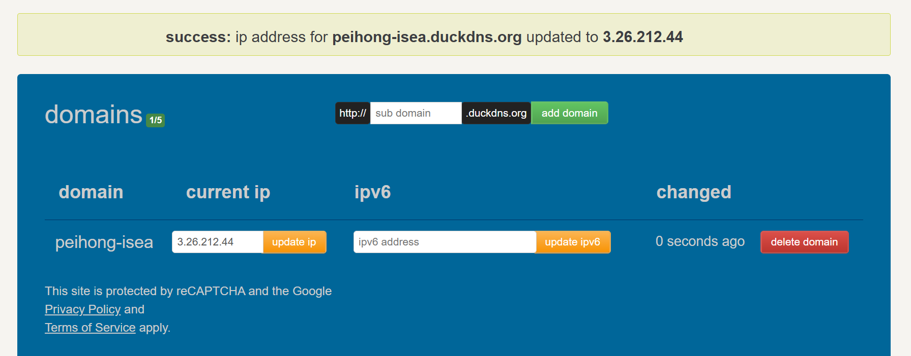
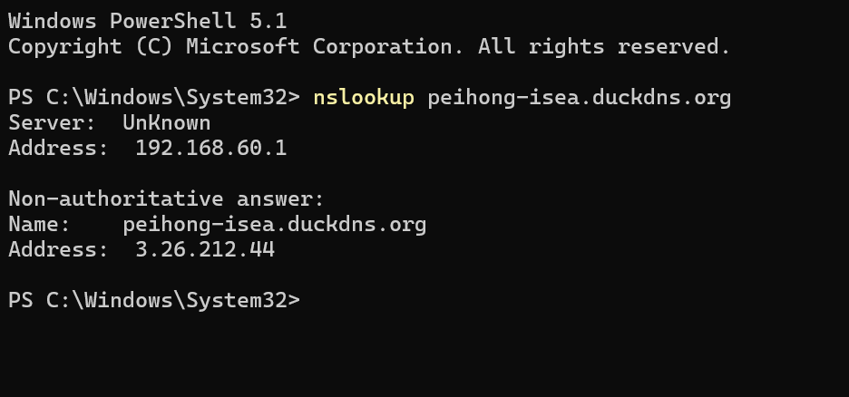
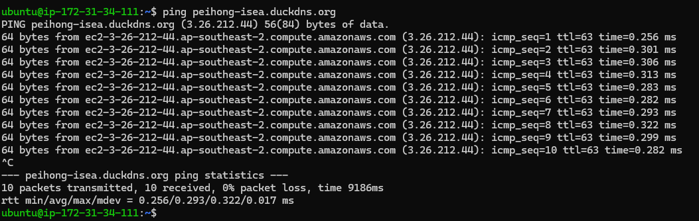
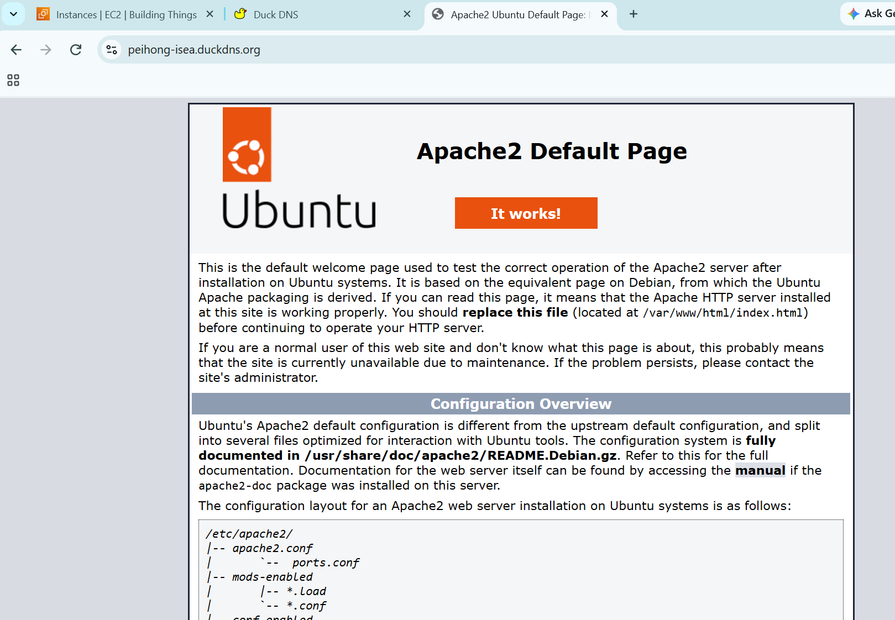
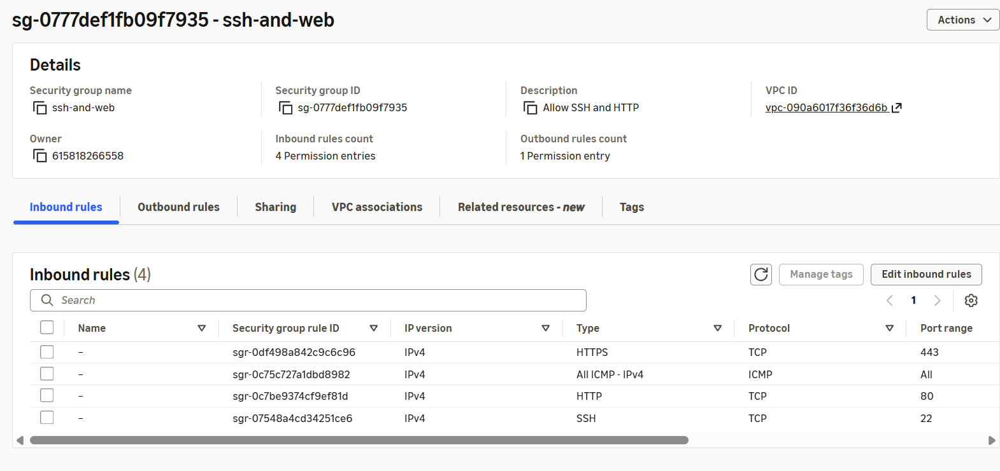
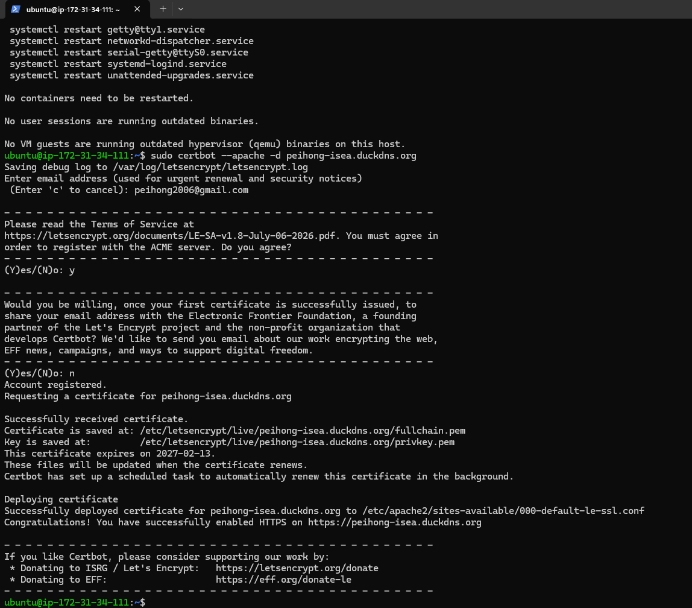
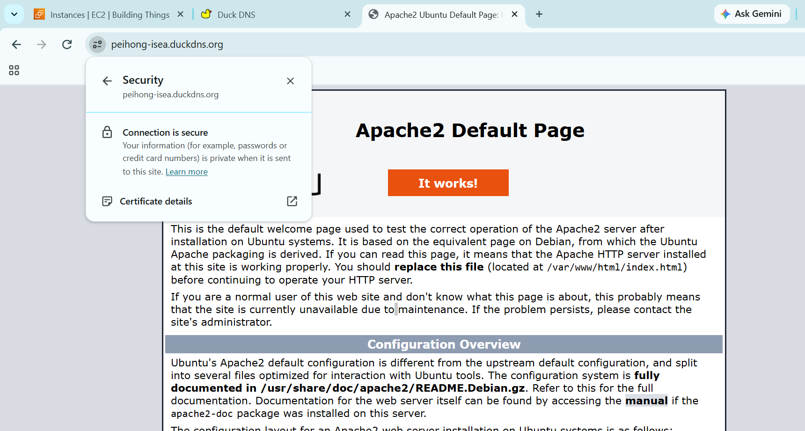
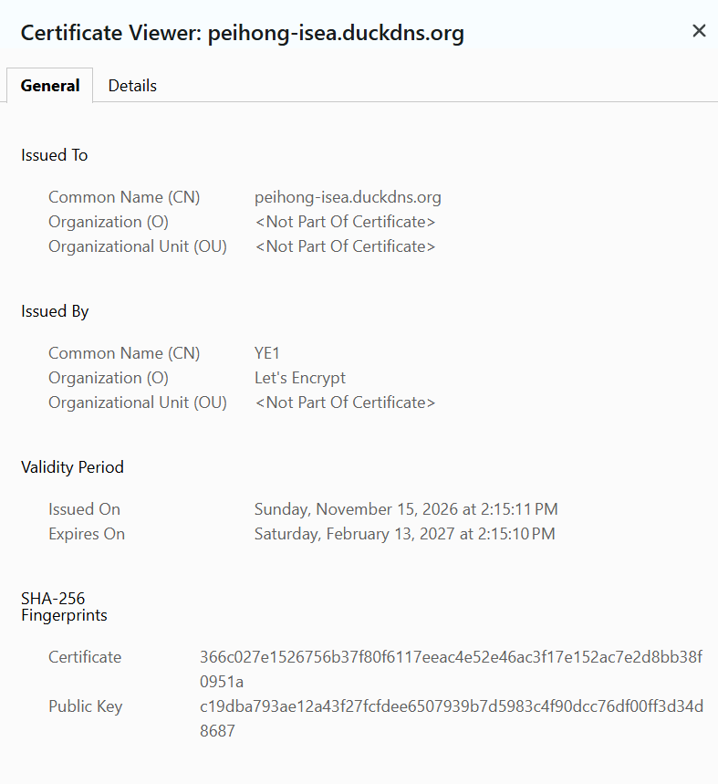
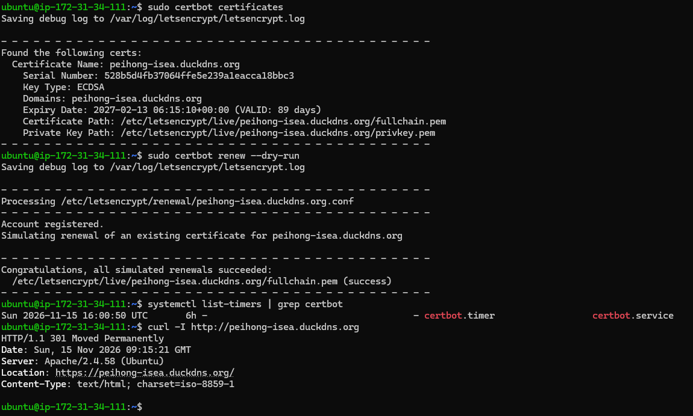

# Lab 3a – Domain, DNS and HTTPS with Let's Encrypt

| Student Name | Tsen Pei Hong |
|---|---|
| Kaplan ID | CT0375497 |
| Murdoch ID | 36431456 |
| Module | BRG-31-ISEA – Introduction to Server Environments and Architectures |
| Date | 15 Nov 2026 |

This document covers Lab 3a-1 (Domain, DNS and TLS Certificates) and Lab 3a-2 (Enabling HTTPS with Let's Encrypt & Certbot).

| Server | AWS EC2 Ubuntu 24.04 (from Lab 2a-2), IP 3.26.212.44 |
|---|---|
| Domain | peihong-isea.duckdns.org (free, DuckDNS) |
| Web server | Apache 2.4.58 |
| Certificate | Let's Encrypt, issued 15 Nov 2026, expires 13 Feb 2027 |

## Part A – Lab 3a-1: Domain and DNS

### Step 1 – Register a domain and create the A record (Deliverables 1, 2)

Instead of buying a domain, I used DuckDNS (free). I created the subdomain peihong-isea and changed the IP from my home IP to my EC2 public IP 3.26.212.44. This works like an A record.

### Step 2 – Apache running (Deliverable 3)

Apache was already installed in Lab 2a-2 and is reachable on port 80 (see Lab 2a-2 Step 7).

### Step 3 – Verify DNS mapping (Deliverables 4, 6)

nslookup returns 3.26.212.44. The answer is 'non-authoritative' because it came from my router's DNS cache, not directly from DuckDNS's server. Ping by name also resolves to the same IP.

### Step 4 – Apache page via domain (Deliverable 5)

Opened the site using the domain name instead of the IP address.

## Part B – Lab 3a-2: HTTPS with Let's Encrypt

### Step 5 – Firewall port 443

Added an HTTPS (443) inbound rule to the security group so browsers can connect with HTTPS.

### Step 6 – Install Certbot and get the certificate (Deliverables 2, 3, 4)

Installed Certbot with the Apache plugin, then ran Certbot for my domain. Let's Encrypt checked that I control the domain, issued the certificate, and Certbot configured Apache for HTTPS automatically.
Note: the lab sheet installs Certbot with snap. I used apt (sudo apt install certbot python3-certbot-apache), which installs the same tool from Ubuntu's own repository.

sudo apt install certbot python3-certbot-apache -y
sudo certbot --apache -d peihong-isea.duckdns.org

### Step 7 – Secure connection in browser (Deliverable 5)

Chrome shows 'Connection is secure'. (Newer Chrome uses a settings icon instead of the old padlock.)

### Step 8 – Certificate issuer (Deliverable 6)

The certificate is issued to peihong-isea.duckdns.org by Let's Encrypt (YE1), valid for 90 days. Organisation is 'Not Part Of Certificate' because Let's Encrypt only issues Domain Validation (DV) certificates.

### Step 9 – Certificate list, renewal dry run, timer and HTTP redirect (Deliverables 7, 8, 9)

certbot certificates shows the certificate (ECDSA, valid 89 days). The dry run shows 'all simulated renewals succeeded'. certbot.timer is scheduled for automatic renewal. curl -I shows '301 Moved Permanently' to https, so HTTP traffic is redirected to HTTPS.

## Deliverables Checklist

Lab 3a-1

| # | Deliverable | Where |
|---|---|---|
| 1 | Domain registered | Step 1 (DuckDNS) |
| 2 | A record created | Step 1 |
| 3 | Apache installed | Step 2 |
| 4 | IP to domain mapping verified | Step 3 |
| 5 | Apache page via domain | Step 4 |
| 6 | DNS test output | Step 3 |
| 7 | Subdomain experiment (optional) | Not done |

Lab 3a-2

| # | Deliverable | Where |
|---|---|---|
| 1 | Domain points to server | Steps 3–4 |
| 2 | Certbot installed | Step 6 (apt instead of snap) |
| 3 | Certificate issued | Step 6 |
| 4 | HTTPS enabled on Apache | Step 6 |
| 5 | Secure connection in browser | Step 7 |
| 6 | Certificate issuer | Step 8 |
| 7 | Renewal dry run | Step 9 |
| 8 | Timer check (optional) | Step 9 |
| 9 | HTTPS redirect (optional) | Step 9 |
| 10 | Expired certificate (bonus) | Explained in Reflection 9 |

## Reflection

**1. What is the role of DNS in Internet presence?**

DNS lets people easily find the website they search for. For example, for YouTube we just type youtube.com, and we do not need to remember its IP address.

**2. Why does DNS propagation take time?**

Because DNS needs to sync around the whole world, it takes time.

**3. What are the risks if TLS is not configured on a public-facing site?**

HTTP sends data in plain text, so hackers can easily get the data.

**4. What happens if a certificate expires and is not renewed?**

Users cannot log in, and the browser shows a red triangle error warning. Users may not trust the website and may leave.

**5. Why does Let's Encrypt require port 80 or 443 to be open for verification?**

Because Let's Encrypt needs to know that I am the administrator who can control the server and its ports.

**6. What entity issued your site's TLS certificate?**

Let's Encrypt (intermediate YE1).

**7. How long is your certificate valid for, and how can it be renewed?**

90 days (15 Nov 2026 to 13 Feb 2027). Certbot set up certbot.timer to renew it automatically, and I tested this with sudo certbot renew --dry-run.

## AI Tools Used

I used Claude to guide me through the steps, suggest the commands and the index.html content, give hints for the reflection questions, format this document, and translate my answers from Chinese to English. I did all the lab work and screenshots myself, and the reflection answers are my own ideas.
