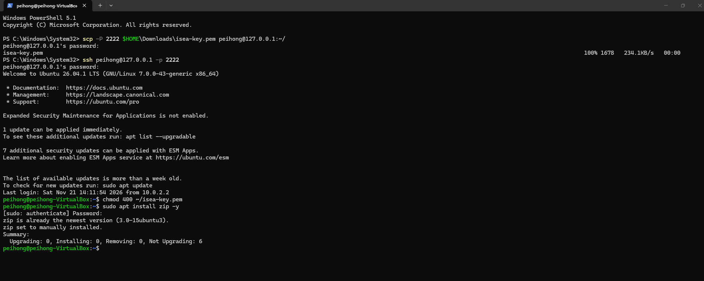
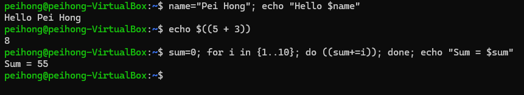
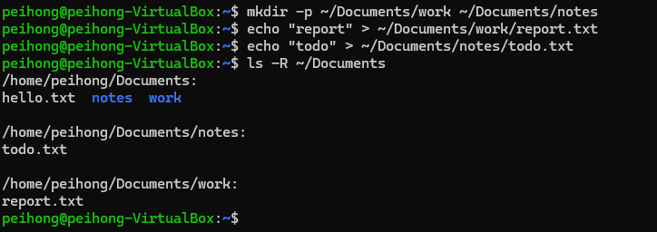
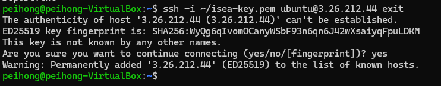
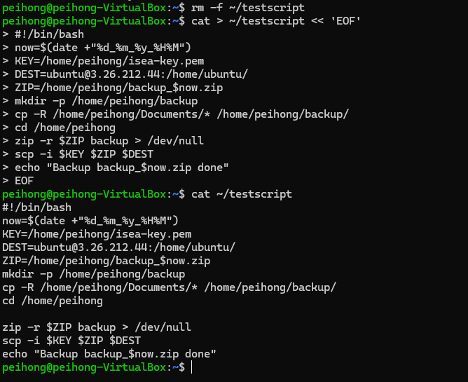
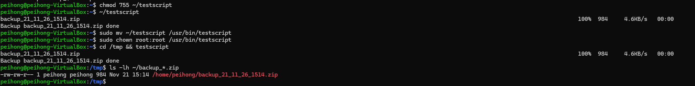
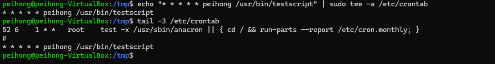
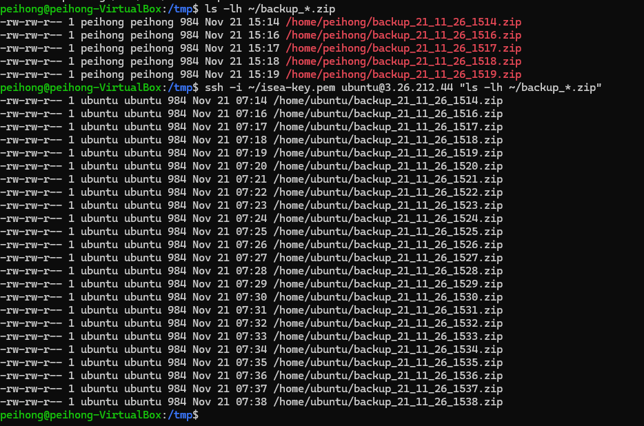
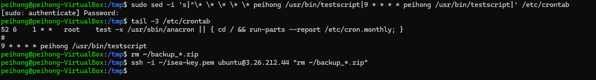

# Lab 3b-1 – Bash Backup Scripting, Cron Jobs & Cloud Export

| Student Name | Tsen Pei Hong |
|---|---|
| Kaplan ID | CT0375497 |
| Murdoch ID | 36431456 |
| Module | BRG-31-ISEA – Introduction to Server Environments and Architectures |
| Date | 21 Nov 2026 |

## Overview

I wrote a Bash backup script on my local Ubuntu VM that copies my Documents folder, zips it with a timestamp, and uploads the zip to my AWS EC2 server with scp. I moved the script to /usr/bin and scheduled it with cron, so backups run automatically and are exported to the cloud.

| Source | Local Ubuntu 26.04 VM (user peihong) |
|---|---|
| Cloud destination | AWS EC2 Ubuntu 24.04, 3.26.212.44 (from Lab 2a-2) |
| Script | /usr/bin/testscript |
| Schedule | 9 * * * * (every hour at minute 9) |

Changes from the lab sheet: my user is peihong, so paths use /home/peihong instead of /home/ubuntu. I added the hour and minute to the zip name (%d_%m_%y_%H%M), because with only the date, every backup on the same day overwrites the previous one. I used chmod 755 instead of 777, so only root can change the script after it is moved to /usr/bin.

## Steps

### Step 0 – Copy the EC2 key to the VM

Copied isea-key.pem from Windows into the VM with scp, set it to chmod 400 (owner read only), and confirmed zip is installed.



### Step 1 – Practice Bash commands (Deliverable 1)

Variables with echo, arithmetic with $(( )), and a for loop that adds 1 to 10.



### Step 2 – Test files and directories (Deliverable 2)

Created work and notes folders with files inside ~/Documents and listed them with ls -R.



### Step 3 – Accept the EC2 SSH fingerprint (Deliverable 9)

Connected once by hand and typed yes, so the EC2 host is saved in known_hosts. Without this, the script would stop at the yes/no question when cron runs it.



### Step 4 – Write the backup script (Deliverables 3, 5, 8, 10)

My first paste split the scp line into two lines, which would have broken the upload. I rewrote the script with variables so every line is short. All paths are absolute so cron can find them.

```
#!/bin/bash
now=$(date +"%d_%m_%y_%H%M")
KEY=/home/peihong/isea-key.pem
DEST=ubuntu@3.26.212.44:/home/ubuntu/
ZIP=/home/peihong/backup_$now.zip
mkdir -p /home/peihong/backup
cp -R /home/peihong/Documents/* /home/peihong/backup/
cd /home/peihong
zip -r $ZIP backup > /dev/null
scp -i $KEY $ZIP $DEST
echo "Backup backup_$now.zip done"
```



### Step 5 – Test, move to /usr/bin and run from any folder (Deliverables 3, 4, 5)

The script created a dated zip and uploaded it to EC2. After moving it to /usr/bin and changing the owner to root, it also runs from /tmp by just typing testscript.



### Step 6 – Schedule with cron (Deliverable 6)

Added the job to /etc/crontab. I first used * * * * * (every minute) so I could see results quickly.



### Step 7 – Verify cron and cloud export (Deliverables 7, 8)

The VM created a new zip every minute, and each one reached the EC2 server. EC2 shows the times in UTC (07:14), while my VM shows Singapore time (15:14, UTC+8).



### Step 8 – Change to hourly and clean up

Within about 25 minutes there were 25 zip files on EC2, so I changed the job to 9 * * * * (hourly) and deleted the test zips on both machines.



## Deliverables Checklist

| # | Deliverable | Where |
|---|---|---|
| 1 | Practice Bash commands | Step 1 |
| 2 | Test files and directories | Step 2 |
| 3 | Basic script working | Steps 4–5 |
| 4 | Script in /usr/bin | Step 5 |
| 5 | Dated ZIP | Steps 4–5 |
| 6 | Cron job | Steps 6, 8 |
| 7 | Cron execution verified | Step 7 |
| 8 | SCP to cloud | Steps 5, 7 |
| 9 | SSH fingerprint accepted | Step 3 |
| 10 | Final script | Step 4 |
| 11 | Boot-time script (optional) | Not done |
| 12 | MOTD with figlet/neofetch (optional) | Not done |

## Reflection

**1. Why is using absolute paths important in scripts run by cron?**

To avoid cron not being able to find the files, which would make the command fail.

**2. What are the benefits of cloud exporting for backups?**

If the server has a problem or crashes, we do not need to worry about losing data, and we can restore it to a server that is working.

**3. How does cron differ from manual execution?**

Cron automatically runs the commands we set at the time we choose. Manual means doing it by hand, which also uses up staff time.

**4. What happens if SSH keys are not accepted ahead of time?**

If the answer is no, SSH refuses the connection and shows an error, so the script gets stuck or fails.

**5. What challenges did you face automating with cron?**

If I had not noticed this detail, there would be many zip files on EC2. If nobody notices for a long time, it could fill up the storage for no reason.

**6. How would you improve this script for a production environment?**

Use cron to run the backup automatically, and send a notice to the IT department when strange logs appear.

## AI Tools Used

I used Claude to guide me through the steps and commands, help fix the script when the scp line was split, give hints for the reflection questions, format this document, and translate my answers from Chinese to English. I ran all the commands and took the screenshots myself, and the reflection answers are my own.
